## FELADATMONDAT-SZÓTÁR (ezt keresd először!)

> Itt a **feladat saját szavával** keresel (Ctrl+F). A jobb oldali „Keress a kártyán" szót a kártyán belül írd be, az odavezet a kész kódhoz.

| Ha a feladat ezt mondja... | Kártya | Keress a kártyán |
|---|---|---|
| gombra kattintva nőjön / csökkenjen valami (számláló, példányszám) | **K17** (gomb + függvény), osztályba: **K08** | `(click)` |
| a mezőbe írt szöveg azonnal jelenjen meg | **K17** | `[(ngModel)]`, aztán `{{` |
| ár ezres tagolással, Ft-tal | **K16** | `toLocaleString` vagy `currency` |
| három menüpont / aloldal, oldal újratöltése nélkül | **K13** | `routerLink`, `path:` |
| menüsor (navbar) | **K01** (Bootstrap), **K13** (routing) | `navbar` |
| új komponens, bárhol elhelyezhető, paramétert kap | **K14** | `@Input` |
| ugyanabból három példány, más-más adattal | **K14** (komponens), **K08** (osztály) | `<app-`, `new ` |
| ha igaz, akkor kerüljön rá egy class (pl. akcio) | **K14** | `[class.` |
| színt / méretet SCSS változóból, _colors.scss | **K05** | `@use`, `$` |
| osztály, privát mező, hibás értéknél ne jöjjön létre | **K08** | `throw new Error`, `#` |
| kiírásnál „Cím (ISBN)" alakú szöveg | **K08** | `toString` |
| lista kiírása, ismétlődő elemek | **K16** | `*ngFor` |
| adatok tárolása, service | **K16** | `@Injectable` |
| űrlap, új elem hozzáadása a listához | **K17** | `push` |
| gomb tiltva, ha üres a mező | **K17** | `[disabled]` |
| hibaüzenet kiírása (kivétel miatt) | **K17**, **K08** | `try`, `catch` |
| törlés / szerkesztés / keresés | **K18** | `splice`, `filter` |
| átlag, legnagyobb, legkisebb, darabszám | **K19** | `reduce` |
| maradjon meg újratöltés után | **K20** | `localStorage` |
| adat szerverről (API) | **K21** | `HttpClient`, `subscribe` |
| belépés, kilépés | **K22** | `token` |
| gyerek szóljon a szülőnek | **K15** | `@Output` |
| teszt fut, mit kér a spec | **K25** | `spec` |
| hibaüzenet a konzolon | **K26** | a hiba első szavát |
| publikálás | **K24** | `firebase deploy` |

**Nincs külön kártya:** egyszerű számláló (kattintásra +1). Ott a K17 (gomb + függvény) és a `tanari-anyag/counter-app` mappa a minta.

Ebben a fájlban VS Code-ban **Ctrl + Shift + V** (szebb, formázott nézet).

1. Olvasd a **tartalomjegyzéket** lent: a jobb oldali szavak a feladat szavai.
2. Kattints a kártyára (vagy Ctrl+F: `K14`).
3. A kártyán minden együtt van: **lépések + kész kód + hol van + mit írj át + tipikus hiba**. Másolj, írd át, tesztelj.

> Mindent az ADOTT feladat szerint írj át (nevek, mezők, útvonalak). A kártyák Angular 17 modulos felépítést használnak (`app.module.ts`). Ha a vizsga projektje standalone, a komponens `imports` listájába kerül a `FormsModule`, `RouterLink`, `CommonModule`.

**A mintalap 3., 4., 5. feladata kész mappában:** [`vizsgalap-feladatok/`](vizsgalap-feladatok/01-aloldalak-routing-navbar/LEPESEK.md) (aloldalak + routing, widget + SCSS, osztály + űrlap + lista; mondatonként a megoldás).


| | | |
|---|---|---|
| <a href="#k13-aloldalak-routing-navigációs-sáv">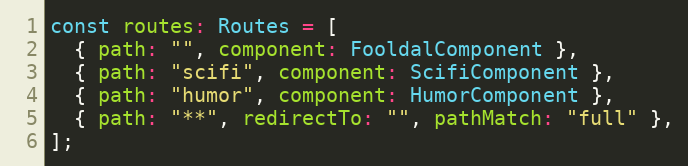<br><b>Aloldalak, routing</b></a> | <a href="#k14-widget-paraméterrel-input-akcio-class-három-példány">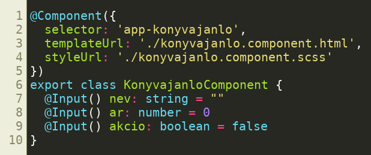<br><b>Widget (@Input)</b></a> | <a href="#k17-új-elem-űrlapról-validáció-gomb-tiltás-lista-tárolása-tegye-interaktívvá">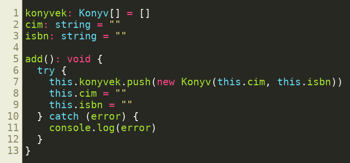<br><b>Űrlap + lista</b></a> |
| <a href="#k08-osztály-privát-mező-ellenőrzés-kivétellel-tostring">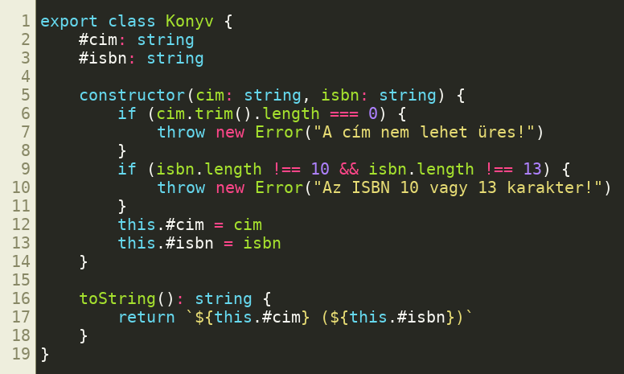<br><b>Osztály, privát mező</b></a> | <a href="#k05-scss-változó-mixin-extend-_colorsscss-akcio-class">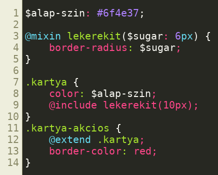<br><b>SCSS</b></a> | <a href="#k16-model--service--lista-oldal">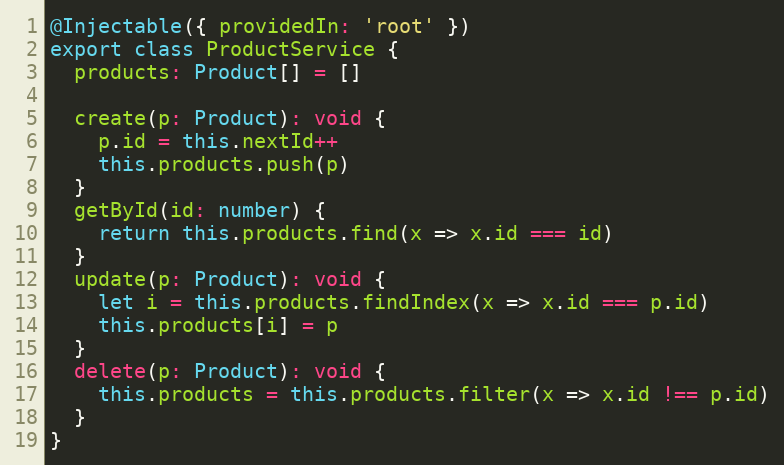<br><b>Service (CRUD)</b></a> |
| <a href="#k22-login--logout-token">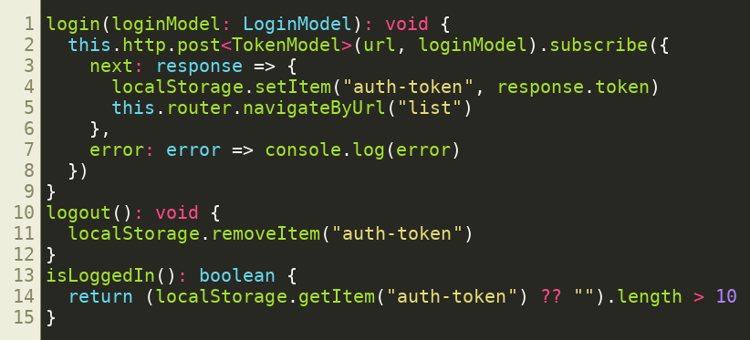<br><b>Login / logout</b></a> | <a href="#k20-mentés-újratöltés-után-localstorage">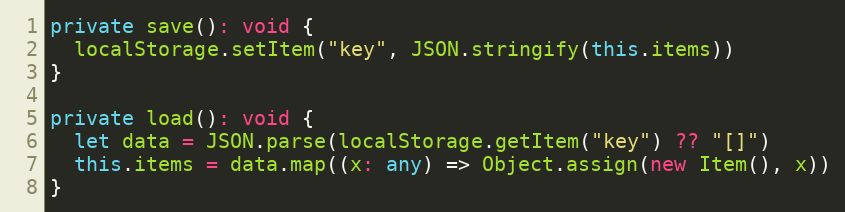<br><b>localStorage</b></a> | <a href="#k18-törlés-szerkesztés-editid-keresés">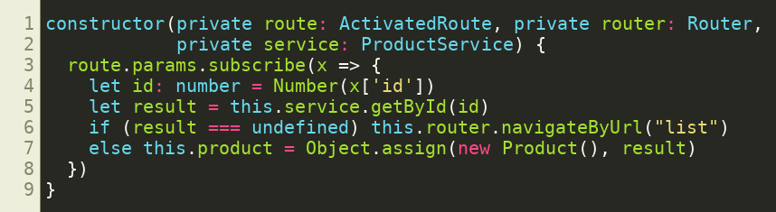<br><b>Szerkesztés edit/:id</b></a> |
| <a href="#k15-szülő-gyerek-komponens-output">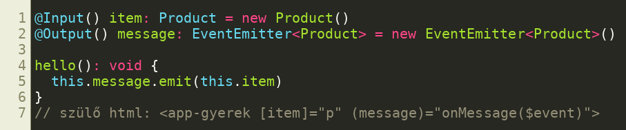<br><b>@Output</b></a> | <a href="#k21-adat-szerverről-httpclient-get--post--put--delete">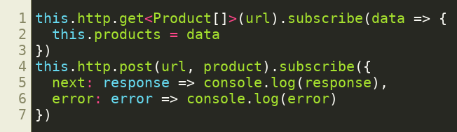<br><b>HttpClient</b></a> | <a href="#k12-angular-új-projekt-parancsok-fájlfa-hova-mi-kerül">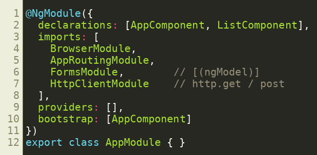<br><b>app.module</b></a> |
| <a href="#k01-statikus-oldal-bootstrap-pel">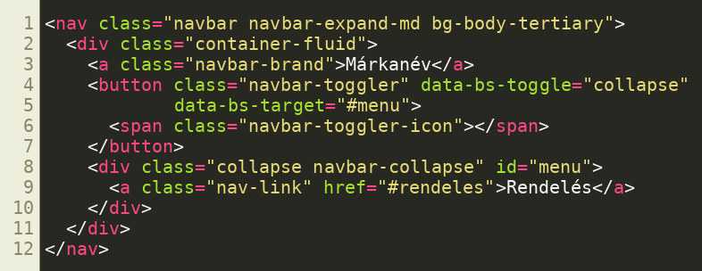<br><b>Bootstrap navbar</b></a> | <a href="#k03-css-animáció-hover-transition-transform">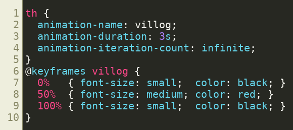<br><b>CSS animáció</b></a> | <a href="#k04-css-elrendezés-flex-grid-position-mobil">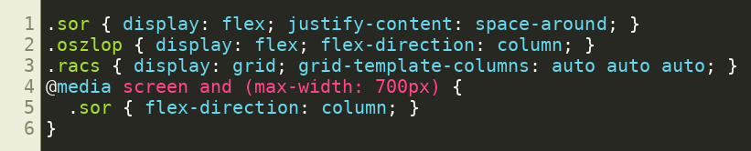<br><b>Flex, grid, mobil</b></a> |
| <a href="#k07-tömbök-és-programozási-tételek">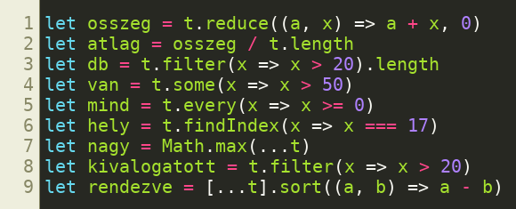<br><b>Tömb tételek</b></a> | <a href="#k23-git-commit-ág-merge-push">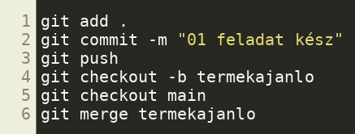<br><b>Git</b></a> |  |

## TARTALOMJEGYZÉK

**A. HTML / CSS / Bootstrap / SCSS**

| Kártya | Ha a feladat ezt mondja... |
|---|---|
| [K01 Statikus oldal Bootstrap-pel](#k01-statikus-oldal-bootstrap-pel) | weboldal, navigációs sáv, hamburger menü, űrlap két oszlopban, csíkozott táblázat, galéria, képek egymás mellett, szemantikus elemek, alt, Bootstrap bekötés, CDN, link, script, Bootstrap ikonok, bi bi-trash, container, row, col |
| [K02 Űrlap elemek](#k02-űrlap-elemek) | űrlap, input, szám / dátum / jelszó mező, kötelező (required), legördülő, rádiógomb, jelölőnégyzet, csúszka, textarea, label for, disabled, autofocus |
| [K03 CSS animáció, hover, transition, transform](#k03-css-animáció-hover-transition-transform) | animáció, @keyframes, hover, egér fölött, transition, transform, forgat, nagyít, végtelenített, th |
| [K04 CSS elrendezés: flex, grid, position, mobil](#k04-css-elrendezés-flex-grid-position-mobil) | egymás mellé, egymás alá, középre, flexbox, grid, rács, position fixed, float, box model, margin, padding, reszponzív, @media, kisebb képernyőn, mobil, CSS változó |
| [K05 SCSS: változó, mixin, @extend, _colors.scss, akcio class](#k05-scss-változó-mixin-extend-_colorsscss-akcio-class) | SCSS, változó, mixin, @extend, _colors.scss, @use, félkövér, az alapértelmezettnél nagyobb betűméret, class definiálása, kimeneti CSS, kiemeles változó |

**B. JavaScript**

| Kártya | Ha a feladat ezt mondja... |
|---|---|
| [K06 JavaScript: konzolos program (prompt, if, ciklus, függvény)](#k06-javascript-konzolos-program-prompt-if-ciklus-függvény) | kérjen be, prompt, parseInt, if / else, ciklus, while, for, függvény, véletlen szám, jatt, számlafelosztás |
| [K07 Tömbök és programozási tételek](#k07-tömbök-és-programozási-tételek) | összeg, átlag, hány darab, megszámlálás, van-e olyan, legnagyobb, legkisebb, keresés, hanyadik helyen, kiválogatás, rendezés, some, every, filter, reduce, ciklusok |
| [K08 Osztály, privát mező, ellenőrzés kivétellel, toString](#k08-osztály-privát-mező-ellenőrzés-kivétellel-tostring) | osztály, konstruktor, privát tagváltozó #, a konstruktor ellenőrzi, kivétellel jelezze, throw, ISBN, toString Cím (ISBN), getter, setter, JSON, Object.assign, try catch |
| [K09 Szöveg, dátum, Map, Set, Date JSON után](#k09-szöveg-dátum-map-set-date-json-után) | szöveg, substring, replace, split, nagybetűs, tartalmaz, dátum, határidő, napok különbsége, Map, Set, kulcs-érték, egyedi elemek |
| [K10 Sima JavaScript: táblázat kiírása (DOM)](#k10-sima-javascript-táblázat-kiírása-dom) | weboldalon belül JavaScript, gombra kerüljön a táblázatba, innerHTML, getElementById, onclick, display(), duplázódik |
| [K11 OOP: öröklődés, interfész](#k11-oop-öröklődés-interfész) | öröklődés, extends, super, override, interfész, implements, protected, polimorfizmus, egységbezárás, absztrakció, SOLID |

**C. Angular alap**

| Kártya | Ha a feladat ezt mondja... |
|---|---|
| [K28 Az egész app felépítése sorrendben (a tanár menete)](#k28-az-egész-app-felépítése-sorrendben-a-tanár-menete) | az egész alkalmazás felépítése, sorrend, hol kezdjem, komponensek legenerálása, navigáció, router outlet, routing, váz, API-val is, lépésről lépésre építeni |
| [K12 Angular: új projekt, parancsok, fájlfa, hova mi kerül](#k12-angular-új-projekt-parancsok-fájlfa-hova-mi-kerül) | új projekt, ng new, ng generate, ng g c, ng g s, ng g class, fájlfa, hova írjam, melyik fájlba, app.module, declarations, FormsModule, HttpClientModule, standalone |
| [K13 Aloldalak, routing, navigációs sáv](#k13-aloldalak-routing-navigációs-sáv) | három aloldal, frontend routing, útvonal, URL, főoldal, navigációs sáv bootstrap segítségével, oldal újratöltése nélkül, routerLink, átirányítás, ismeretlen cím, bekezdés / lista / táblázat az oldalon |
| [K14 Widget paraméterrel (@Input), akcio class, három példány](#k14-widget-paraméterrel-input-akcio-class-három-példány) | új komponens X néven, widget, bárhol elhelyezhető, @Input, paraméter, opcionális, alapértéke false, akcio, név 3-as szintű címsor, ár bekezdés, class rákerül, három példány a fő komponensben, félkövér, kis-nagybetűs használata, boolean paraméter, mitől lesz true, feltételes class (K39) |
| [K15 Szülő-gyerek komponens (@Output)](#k15-szülő-gyerek-komponens-output) | a gyerek értesíti a szülőt, @Output, EventEmitter, komponensek közti kommunikáció, gombnyomásra a szülő tudjon róla |

**D. Angular adat, tárolás, login**

| Kártya | Ha a feladat ezt mondja... |
|---|---|
| [K16 Model + service + lista oldal](#k16-model--service--lista-oldal) | osztály / modell, service, lista tárolása, create / read / update / delete, ngFor, táblázat a listából, forint formátum, currency, induló adatok (seed) |
| [K17 Új elem űrlapról: validáció, gomb tiltás, lista tárolása, "tegye interaktívvá"](#k17-új-elem-űrlapról-validáció-gomb-tiltás-lista-tárolása-tegye-interaktívvá) | űrlap, új elem hozzáadása, gomb tiltása, ngModel, validáció, tegye interaktívvá, a fő komponens tárolja a listát, a lista végéhez, a form ürítése, kivétellel jelezze a hibát |
| [K18 Törlés, szerkesztés (edit/:id), keresés](#k18-törlés-szerkesztés-editid-keresés) | törlés gomb, szerkesztés, szerkesztő oldal, edit/:id, ActivatedRoute, útvonal paraméter, keresés, szűrés, másolat, Object.assign |
| [K19 Statisztika: átlag, legnagyobb, legkisebb, darabszám](#k19-statisztika-átlag-legnagyobb-legkisebb-darabszám) | átlagár, legdrágább, legolcsóbb, hány akciós, statisztika, reduce |
| [K20 Mentés újratöltés után (localStorage)](#k20-mentés-újratöltés-után-localstorage) | mentse el, újratöltés után is maradjon, tárolja a böngészőben, localStorage, JSON.stringify, JSON.parse, kulcs |
| [K21 Adat szerverről: HttpClient (get / post / put / delete)](#k21-adat-szerverről-httpclient-get--post--put--delete) | szerverről, API, végpont, HttpClient, get, post, put, delete, subscribe, next, error, Network fül |
| [K22 LOGIN / LOGOUT (token)](#k22-login--logout-token) | login, bejelentkezés, token, kijelentkezés, logout, be van-e lépve, isLoggedIn, csak belépve látszik, AuthService, LoginModel, TokenModel, localStorage token, védett menüpont |

**E. Beadás, hibák**

| Kártya | Ha a feladat ezt mondja... |
|---|---|
| [K23 Git: commit, ág, merge, push](#k23-git-commit-ág-merge-push) | git, commit, push, ág, merge, .gitignore, clone, init, add, beadás, termekajanlo ág, node_modules |
| [K24 Build + Firebase Hosting](#k24-build--firebase-hosting) | build, ng build, publikálás, Firebase, hosting, firebase deploy, firebase.json, dist, élő oldal, egyoldalas alkalmazás |
| [K25 Vizsgai induló rutin, tesztek, időbeosztás](#k25-vizsgai-induló-rutin-tesztek-időbeosztás) | vizsga kezdés, hol kezdjem, teszt fájl, spec, automata teszt, nem fordul le, első 10 perc, időbeosztás, 6 feladat, 30 perc, elakadtam |
| [K26 Hibák: üzenet -> ok -> javítás](#k26-hibák-üzenet---ok---javítás) | hibaüzenet, nem működik, is not a known element, Can't bind to ngModel, No provider for HttpClient, undefined, object Object, nem tűnik el, nothing added to commit, GH007 |
| [K27 Szótár: mit jelentenek az Angular szavak](#k27-szótár-mit-jelentenek-az-angular-szavak) | mit jelent, szótár, komponens, selector, modul, service, injektálás, model, decorator, binding, Observable, subscribe, pipe, ?., ?? |

**F. Teljes tanári minta (Developer / Devcrud)**

| Kártya | Ha a feladat ezt mondja... |
|---|---|
| [K29 Developer (Devcrud) teljes projekt: fájltérkép](#k29-developer-devcrud-teljes-projekt-fájltérkép) | developer, devcrud, a teljes tanári projekt, hol van a lista / szerkesztés / törlés / statisztika / skill, mappa, fájltérkép, szűrés skill szerint, select ngValue, ng-template else, canActivate, védett útvonal |

**G. Parancsok, tömbök, komplex feladatok, dokumentáció, tananyag-térkép**

| Kártya | Ha a feladat ezt mondja... |
|---|---|
| [K30 Parancsok egy helyen (ng, npm, git, node, sass, tsc, VS Code)](#k30-parancsok-egy-helyen-ng-npm-git-node-sass-tsc-vs-code) | parancs, parancsok, terminál, ng new, ng g, ng serve, ng build, ng test, npm i, npm install, npm run, node, git, sass, tsc, VS Code billentyű, gyorsbillentyű, parancssor |
| [K31 Tömb metódusok konkrét példával](#k31-tömb-metódusok-konkrét-példával) | tömb, tömbmetódus, push, pop, shift, unshift, slice, splice, concat, indexOf, includes, join, reverse, sort, forEach, map, filter, find, findIndex, some, every, reduce, flat, spread, Set, split |
| [K32 Komplex JavaScript feladat: osztálynapló](#k32-komplex-javascript-feladat-osztálynapló) | komplex feladat, nagyobb JavaScript feladat, osztály, tömb, statisztika, átlag, legjobb, rendezés, keresés, törlés, JSON mentés, betöltés, kivétel, privát mező, toJSON, flatMap |
| [K33 Komplex Angular feladat: webshop (termékek, kosár)](#k33-komplex-angular-feladat-webshop-termékek-kosár) | komplex Angular feladat, webshop, kosár, termékek, készlet, végösszeg, darabszám, jelvény, badge, két service, keresés, localStorage, routing, navbar |
| [K34 Dokumentáció használata: Bootstrap, Angular, MDN](#k34-dokumentáció-használata-bootstrap-angular-mdn) | dokumentáció, Bootstrap oldal, getbootstrap, Angular oldal, angular.dev, MDN, keresés, oldalsáv, hol találom, súgó, internet |
| [K35 Angular életciklus-metódusok (lifecycle hooks) és generikus típus](#k35-angular-életciklus-metódusok-lifecycle-hooks-és-generikus-típus) | életciklus, lifecycle, ngOnInit, ngOnDestroy, ngOnChanges, ngDoCheck, ngAfterViewInit, ngAfterContentInit, constructor, implements OnInit, generikus típus, Tomb<T>, Array<string> |
| [K36 Új Angular szintaxis: @if, @for, @switch, @defer](#k36-új-angular-szintaxis-if-for-switch-defer) | új szintaxis, @if, @else, @for, @empty, @switch, @case, @defer, vezérlési folyamat, *ngIf helyett, *ngFor helyett, track |
| [K37 Linter és formatter (ESLint, Prettier, .editorconfig)](#k37-linter-és-formatter-eslint-prettier-editorconfig) | linter, formatter, ESLint, Prettier, .prettierrc, .editorconfig, kódformázás, kódolási konvenció, clean code, ng lint, format on save, egységes stílus |
| [K38 Tananyag-térkép: a tanfolyam minden mappája és hol van a puskában](#k38-tananyag-térkép-a-tanfolyam-minden-mappája-és-hol-van-a-puskában) | tananyag, térkép, zip, mappák, modulok, melyik mappa mit tartalmaz, hol van a tanári anyag, 01, 02, 15, 16, 22, 25, devcrud, counter app, todo, movieapp, hosting |
| [K39 Feltételes class és stílus: [class.x], [ngClass], boolean paraméter (akcio)](#k39-feltételes-class-és-stílus-classx-ngclass-boolean-paraméter-akcio) | feltételes class, ha az akcio true akkor class, ha igaz akkor class, [class.akcio], [ngClass], [style], boolean paraméter, alapérték false, mitől lesz true, true-ra állítás, opcionális paraméter, class rákerül az ár bekezdésére, nem @if |


---

# A. HTML / CSS / Bootstrap / SCSS

<a name="k01"></a>

## K01 Statikus oldal Bootstrap-pel

**Jelek a feladatban:** weboldal, navigációs sáv, hamburger menü, űrlap két oszlopban, csíkozott táblázat, galéria, képek egymás mellett, szemantikus elemek, alt, Bootstrap bekötés, CDN, link, script, Bootstrap ikonok, bi bi-trash, container, row, col


### Bootstrap bekötése (CDN) és Bootstrap ikonok

1. Nyisd meg az `index.html`-t (Angularban: `src/index.html`; **ne** a komponens html-jébe!).
2. A **CSS** a `<head>`-be kerül, a **JS** a `</body>` elé (a JS kell a hamburger menühöz és a modalhoz).
3. **Ikonok:** külön stíluslap kell a `<head>`-be (a Bootstrap CSS mellé).
4. Mentés, `ng serve`: az ikon a böngészőben megjelenik, ha nem: F12 > Network, nem piros-e a CDN kérés.

```html
<head>
  <!-- Bootstrap CSS -->
  <link href="https://cdn.jsdelivr.net/npm/bootstrap@5.3.8/dist/css/bootstrap.min.css" rel="stylesheet">
  <!-- Bootstrap IKONOK (külön stíluslap!) -->
  <link rel="stylesheet" href="https://cdn.jsdelivr.net/npm/bootstrap-icons@1.13.1/font/bootstrap-icons.min.css">
</head>
<body>
  <app-root></app-root>
  <!-- Bootstrap JS: a </body> elé -->
  <script src="https://cdn.jsdelivr.net/npm/bootstrap@5.3.8/dist/js/bootstrap.bundle.min.js"></script>
</body>
```

**Ikon használata:** `<i class="bi bi-ikonneve"></i>` (a `bi` mindig kell, utána az ikon neve). Gombban, linkben, bárhol, szöveg mellett:

```html
<button class="btn btn-danger" (click)="service.delete(p)"><i class="bi bi-trash"></i> Töröl</button>
<button class="btn btn-warning" routerLink="/edit/{{ p.id }}"><i class="bi bi-pencil-square"></i> Szerkeszt</button>
<a class="nav-link" routerLink="/list"><i class="bi bi-card-list"></i> Lista</a>
<a class="nav-link" routerLink="/create"><i class="bi bi-plus-circle-fill"></i> Új</a>
<a class="nav-link" routerLink="/login"><i class="bi bi-box-arrow-in-right"></i> Login</a>
```

A tanári projektben használt ikonok: `bi-trash` (törlés), `bi-pencil-square` / `bi-pencil-fill` (szerkesztés), `bi-file-text` (részletek), `bi-house-fill` (főoldal), `bi-card-list` (lista), `bi-plus-circle-fill` (új), `bi-person-plus-fill` (új személy), `bi-person-x-fill` (törlés személy), `bi-box-arrow-in-right` (belépés), `bi-door-closed-fill` (kilépés).
Más ikon neve: https://icons.getbootstrap.com (keresd meg, kattints rá, a név a `bi bi-...` kód; az internet a vizsgán használható).
**Fontos:** ha csak ikon van a gombban (nincs szöveg), adj `aria-label="Törlés"` attribútumot is. A méret: `fs-4` (nagyobb), szín: `text-danger`.

**Fájlok:** `index.html`, `style.css` (kész minta: `html-css-bootstrap-minta/index.html`)

1. `<html lang="hu">`, `<title>`, a Bootstrap CSS a `<head>`-be, JS a `</body>` elé
2. szemantikus váz: `<header>`, `<main>`, `<section id="...">`, `<footer>`
3. navbar: `navbar navbar-expand-md`, hamburger: `navbar-toggler` + `collapse navbar-collapse`; a linkek `href="#azonosito"`
4. űrlap két oszlopban: `<div class="row">` + `col-md-6`; minden mezőhöz `<label for="id">`
5. legördülő: `<select>` + `selected`; rádiógomb: azonos `name`, egy `checked`; jelölőnégyzet; zöld gomb: `btn btn-success`
6. táblázat: `table table-striped`, `<thead>` `<th>`, `<tbody>` `<td>`
7. galéria: `row` + `col-12 col-md-4` + `img-fluid` + `alt`
8. animáció a `style.css`-ben (K03)

**Teszt:** böngészőben szűkítsd az ablakot: hamburger menü jelenik meg, az oszlopok egymás alá esnek.

**`index.html`**
```html
<!DOCTYPE html>
<html lang="hu">
<head>
  <meta charset="UTF-8">
  <meta name="viewport" content="width=device-width, initial-scale=1.0">
  <title>Bagoly Kávézó</title>
  <link href="https://cdn.jsdelivr.net/npm/bootstrap@5.3.8/dist/css/bootstrap.min.css" rel="stylesheet">
  <script src="https://cdn.jsdelivr.net/npm/bootstrap@5.3.8/dist/js/bootstrap.bundle.min.js"></script>
  <link rel="stylesheet" href="style.css">
</head>
<body>
  <header>
    <nav class="navbar navbar-expand-md bg-body-tertiary">
      <div class="container-fluid">
        <a class="navbar-brand">Bagoly Kávézó</a>
        <button class="navbar-toggler" type="button" data-bs-toggle="collapse"
                data-bs-target="#navbarNav" aria-controls="navbarNav"
                aria-expanded="false" aria-label="Menü">
          <span class="navbar-toggler-icon"></span>
        </button>
        <div class="collapse navbar-collapse" id="navbarNav">
          <ul class="navbar-nav">
            <li class="nav-item"><a class="nav-link" href="#rendeles">Rendelés</a></li>
            <li class="nav-item"><a class="nav-link" href="#arlista">Árlista</a></li>
            <li class="nav-item"><a class="nav-link" href="#galeria">Galéria</a></li>
          </ul>
        </div>
      </div>
    </nav>
  </header>

  <main class="container-md mt-4">
    <section id="rendeles">
      <form>
        <div class="row">
          <div class="col-md-6">
            <label class="form-label" for="nev">Név</label>
            <input type="text" class="form-control" id="nev" autofocus>
            <label class="form-label mt-3" for="varos">Város</label>
            <select class="form-select" id="varos">
              <option selected>Budapest</option>
              <option>Szeged</option>
              <option>Debrecen</option>
            </select>
          </div>
          <div class="col-md-6">
            <label class="form-label">Átvétel módja</label>
            <div class="form-check">
              <input class="form-check-input" type="radio" name="atvetel" id="helyben" checked>
              <label class="form-check-label" for="helyben">Helyben</label>
            </div>
            <div class="form-check">
              <input class="form-check-input" type="radio" name="atvetel" id="futar">
              <label class="form-check-label" for="futar">Futár</label>
            </div>
            <div class="form-check">
              <input class="form-check-input" type="radio" name="atvetel" id="csomagpont">
              <label class="form-check-label" for="csomagpont">Csomagpont</label>
            </div>
            <div class="form-check mt-3">
              <input class="form-check-input" type="checkbox" id="hab">
              <label class="form-check-label" for="hab">Kérek tejszínhabot</label>
            </div>
            <button type="button" class="btn btn-success mt-3">Rendelés</button>
          </div>
        </div>
      </form>
    </section>

    <section id="arlista" class="mt-5">
      <table class="table table-striped">
        <thead>
          <tr><th scope="col">Termék</th><th scope="col">Méret</th><th scope="col">Ár</th></tr>
        </thead>
        <tbody>
          <tr><td>Espresso</td><td>S</td><td>700 Ft</td></tr>
          <tr><td>Latte</td><td>M</td><td>900 Ft</td></tr>
          <tr><td>Cappuccino</td><td>M</td><td>850 Ft</td></tr>
          <tr><td>Tea</td><td>L</td><td>600 Ft</td></tr>
        </tbody>
      </table>
    </section>

    <section id="galeria" class="mt-5">
      <div class="row">
        <div class="col-12 col-md-4"></div>
        <div class="col-12 col-md-4"></div>
        <div class="col-12 col-md-4"></div>
      </div>
    </section>
  </main>

  <footer class="container-md mt-5 mb-3"><small>© Bagoly Kávézó</small></footer>
</body>
</html>
```

**`style.css`**
```css
th {
    animation-name: villog;
    animation-duration: 3s;
    animation-iteration-count: infinite;
}

@keyframes villog {
    0%   { font-size: small;  color: black; }
    50%  { font-size: medium; color: red;   }
    100% { font-size: small;  color: black; }
}
```

Bootstrap rács: `col-12 col-md-4` = telefonon teljes szélesség, md-től 3 egy sorban. Térköz: `mt-3`, `mb-2`, `p-3` (m = margin, p = padding; t b s e = irány; 1-5 = méret).

[↑ vissza a tartalomjegyzékhez](#tartalomjegyzék)

---

<a name="k02"></a>

## K02 Űrlap elemek

**Jelek a feladatban:** űrlap, input, szám / dátum / jelszó mező, kötelező (required), legördülő, rádiógomb, jelölőnégyzet, csúszka, textarea, label for, disabled, autofocus

**`urlap-elemek.html`**
```html
<!doctype html>
<html lang="hu">
<head><meta charset="utf-8"><title>Űrlap elemek</title></head>
<body>
<!-- MIRE JÓ:   az összes gyakori űrlap-elem és attribútum egy helyen.
     MIKOR:     "űrlapot készítsen", "szám / dátum / jelszó mező", "kötelező mező", "csúszka", "szövegdoboz".
     ÁTÍRNI:    az id-k, a feliratok, az attribútumok. A label for = az input id-ja. -->
<form>
    <label for="nev">Név</label>
    <input type="text" id="nev" placeholder="Írd be a neved" required autofocus>   <!-- required = kötelező -->

    <label for="email">E-mail</label>
    <input type="email" id="email">

    <label for="jelszo">Jelszó</label>
    <input type="password" id="jelszo">                                  <!-- a begépelt szöveg rejtett -->

    <label for="kor">Kor</label>
    <input type="number" id="kor" min="0" max="120" value="18">           <!-- min/max = határok, value = alapérték -->

    <label for="datum">Dátum</label>
    <input type="date" id="datum">

    <label for="csuszka">Csúszka</label>
    <input type="range" id="csuszka" min="0" max="100" value="50">

    <label for="szoveg">Megjegyzés</label>
    <textarea id="szoveg" rows="3" cols="30"></textarea>                  <!-- több soros szöveg -->

    <label for="varos">Város</label>
    <select id="varos">
        <option>Budapest</option>
        <option selected>Szeged</option>                                  <!-- selected = alapértelmezett -->
    </select>

    <!-- rádiógomb: azonos name = csak egy választható; checked = alapértelmezett -->
    <input type="radio" name="atvetel" id="helyben" checked><label for="helyben">Helyben</label>
    <input type="radio" name="atvetel" id="futar"><label for="futar">Futár</label>

    <!-- jelölőnégyzet: bármennyi bejelölhető -->
    <input type="checkbox" id="hab"><label for="hab">Kérek tejszínhabot</label>

    <input type="text" value="nem szerkeszthető" disabled>                <!-- disabled = le van tiltva -->
    <button type="button">Rendelés</button>                              <!-- type="button": nem küldi el az űrlapot -->
</form>

<!-- EGYÉB ELEMEK -->
<ul><li>felsorolás (sorszám nélkül)</li></ul>
<ol><li>számozott lista</li></ol>
<nav><a href="#">link</a></nav>                                            <!-- nav = navigációs rész -->
<aside>oldalsáv</aside>
<iframe src="https://example.com" width="300" height="150"></iframe>       <!-- másik oldal beágyazása -->
</body>
</html>
```

[↑ vissza a tartalomjegyzékhez](#tartalomjegyzék)

---

<a name="k03"></a>

## K03 CSS animáció, hover, transition, transform

**Jelek a feladatban:** animáció, @keyframes, hover, egér fölött, transition, transform, forgat, nagyít, végtelenített, th


**Animáció a táblázat fejlécére (3 mp, végtelen, méret + szín változik):**

**`style.css`**
```css
th {
    animation-name: villog;
    animation-duration: 3s;
    animation-iteration-count: infinite;
}

@keyframes villog {
    0%   { font-size: small;  color: black; }
    50%  { font-size: medium; color: red;   }
    100% { font-size: small;  color: black; }
}
```
```css
/* egér fölött szín, 2 mp alatt átúszik */
nav a { transition: background-color 2s; }
nav a:hover { background-color: red; }

/* forgatás, nagyítás, eltolás */
.forog { display: inline-block; transition: transform 0.5s; }
.forog:hover { transform: rotate(10deg) scale(1.1); }
```

[↑ vissza a tartalomjegyzékhez](#tartalomjegyzék)

---

<a name="k04"></a>

## K04 CSS elrendezés: flex, grid, position, mobil

**Jelek a feladatban:** egymás mellé, egymás alá, középre, flexbox, grid, rács, position fixed, float, box model, margin, padding, reszponzív, @media, kisebb képernyőn, mobil, CSS változó


Kipróbálható fájl: nyisd meg böngészőben, és játssz az értékekkel.

**`css-alapok-es-elrendezes.html`**
```html
<!doctype html>
<html lang="hu">
<head>
<meta charset="utf-8">
<meta name="viewport" content="width=device-width, initial-scale=1">
<title>CSS minták</title>
<!-- MIRE JÓ:   CSS alapok és elrendezés egy fájlban: változók, box model, flexbox, grid, position, float,
                hover + transition, transform, media query (reszponzív).
     MIKOR:     "egymás mellé", "középre", "rács", "rögzített elem", "ha a képernyő kisebb, mint...", "egérrel fölé víve...".
     ÁTÍRNI:    az osztálynevek, méretek, színek. Nyisd meg böngészőben, és játssz az értékekkel. -->
<style>
    /* CSS változók: egyszer definiálod, bárhol használod: var(--neve) */
    :root {
        --color1: #6f4e37;
        --color2: #d9534f;
    }

    /* SZELEKTOROK: elem (p), class (.kartya), id (#fo), leszármazott (nav a), állapot (a:hover) */
    body { font-family: sans-serif; margin: 20px; }

    /* BOX MODEL: tartalom -> padding (belső tér) -> border (keret) -> margin (külső tér) */
    .doboz {
        width: 200px;
        padding: 10px;                 /* belül */
        border: 2px solid var(--color1);
        margin: 10px;                  /* kívül */
        box-sizing: border-box;        /* a width a paddinggel és kerettel együtt értendő */
        border-radius: 8px;            /* lekerekítés */
        box-shadow: 3px 3px 8px gray;  /* árnyék */
    }

    /* FLEXBOX: gyerekek egy sorban/oszlopban. justify-content = fő irány, align-items = keresztirány */
    .sor { display: flex; justify-content: space-around; }                  /* egymás mellett, szétosztva */
    .oszlop { display: flex; flex-direction: column; align-items: stretch; } /* egymás alatt */
    .kozepre { display: flex; justify-content: center; align-items: center; height: 80px; border: 1px dashed gray; }

    /* GRID: rács sorokkal és oszlopokkal */
    .racs {
        display: grid;
        grid-template-columns: auto auto auto;     /* 3 oszlop (1fr 1fr 1fr = egyenlő) */
        grid-gap: 10px;
    }

    /* POSITION: fixed = a képernyőhöz rögzített; absolute = a legközelebbi relative szülőhöz; relative = eredeti helyéhez képest */
    .rogzitett { position: fixed; top: 10px; right: 10px; background: var(--color2); color: white; padding: 6px; z-index: 10; }

    /* FLOAT: balra/jobbra úsztatás (régi elrendezés) */
    .balra { float: left; width: 80px; }

    /* HOVER + TRANSITION: egér fölött szín, 2 mp alatt átúszik */
    nav a { display: inline-block; padding: 8px; background: var(--color1); color: white; text-decoration: none; transition: background-color 2s; }
    nav a:hover { background: var(--color2); }

    /* TRANSFORM: forgatás, nagyítás, eltolás */
    .forog:hover { transform: rotate(10deg) scale(1.1); }
    .forog { display: inline-block; transition: transform 0.5s; }

    /* MEDIA QUERY: csak akkor érvényes, ha a képernyő max. 700px széles (mobil) */
    @media screen and (max-width: 700px) {
        .sor { flex-direction: column; }           /* mobilon egymás alá */
        .racs { grid-template-columns: auto; }     /* mobilon 1 oszlop */
    }
</style>
</head>
<body>
    <div class="rogzitett">fix elem</div>
    <nav><a href="#">Főoldal</a> <a href="#">Rólunk</a></nav>

    <div class="doboz">box model</div>

    <div class="sor"><div class="doboz">1</div><div class="doboz">2</div><div class="doboz">3</div></div>
    <div class="oszlop"><div class="doboz">A</div><div class="doboz">B</div></div>
    <div class="kozepre">középre igazított</div>

    <div class="racs"><div class="doboz">g1</div><div class="doboz">g2</div><div class="doboz">g3</div><div class="doboz">g4</div></div>

    <div class="forog doboz">hover + forgat</div>
</body>
</html>
```

Mértékegységek: `px` képpont, `%` a szülő százaléka, `vw`/`vh` a képernyő szélessége/magassága %-ban, `rem` az alapbetűméret többszöröse. Mobile-first: előbb a mobil stílus, a nagyobb képernyő `@media (min-width: ...)`.

[↑ vissza a tartalomjegyzékhez](#tartalomjegyzék)

---

<a name="k05"></a>

## K05 SCSS: változó, mixin, @extend, _colors.scss, akcio class

**Jelek a feladatban:** SCSS, változó, mixin, @extend, _colors.scss, @use, félkövér, az alapértelmezettnél nagyobb betűméret, class definiálása, kimeneti CSS, kiemeles változó


**Kép a videóból: változó és fordítás (LESS-ben `@`, SCSS-ben `$` jel; a vizsgán SCSS kell)**

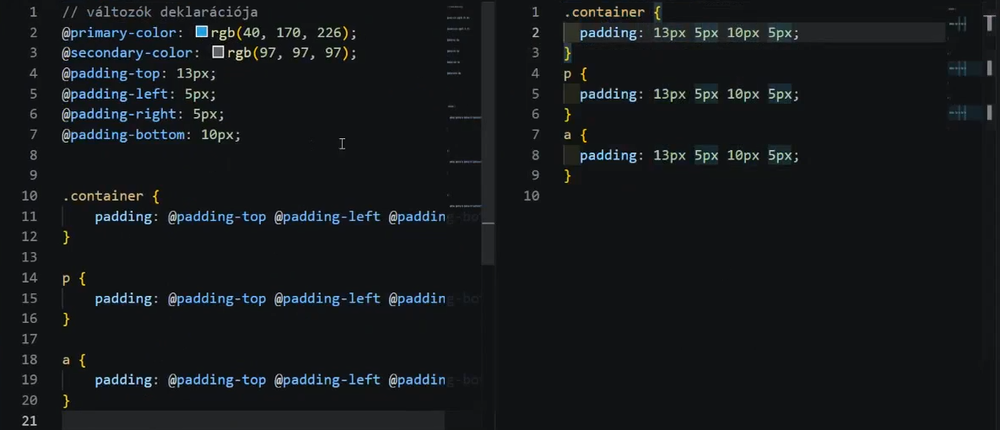

*Kulcsszavak a képhez: változó deklaráció, `@primary-color` (LESS) = `$primary-color` (SCSS), padding, fordítás CSS-re. Bal oldalt a forrás (`.less`), jobb oldalt a lefordított CSS.*

1. Angularban: `ng new ... --style=scss` (a komponensek `.scss` fájlt kapnak), sima oldalnál `npx sass styles.scss styles.css`
2. változó: `$szin: #6f4e37;` használat: `color: $szin;`
3. mixin: `@mixin lekerekit($sugar: 6px) { border-radius: $sugar; }` használat: `@include lekerekit(10px);`
4. extend: `.kartya-akcios { @extend .kartya; border-color: red; }`
5. közös változók külön fájlban: `_colors.scss` (aláhúzással kezdődik)
6. betöltés: `@use 'colors';` használat: `colors.$kiemeles`  (az út a fájltól számítva, aláhúzás és `.scss` nélkül)

**Feladat: "definiálja az `akcio` class-t: félkövér, nagyobb betűméret, a betűszín a `_colors.scss` `kiemeles` változója"** (a mintalapon szerepelt):

**`src/app/_colors.scss`**
```scss
$kiemeles: #b5651d;
$szurke: #666666;
```

**`components/termekajanlo/termekajanlo.component.scss`**
```scss
@use '../../colors';           // a _colors.scss fájlhoz vezető út ettől a fájltól számítva: ../../ = két szinttel feljebb (src/app/_colors.scss)
                               // az aláhúzás és a .scss kimarad. Ha a komponens közvetlenül az app/ alatt van: '../colors'

.akcio {
  font-weight: bold;           // félkövér
  font-size: 1.4rem;           // nagyobb betűméret
  color: colors.$kiemeles;     // colors. + a változó neve
}
```
Az `@use` útja **a fájltól számítva** értendő: `components/termekajanlo/` -> `../../colors` (két szint feljebb). Ha a komponens közvetlenül az `app/` alatt van: `'../colors'`.

**Teljes SCSS minta (változó, mixin, extend):**

**`scss-minta/styles.scss`**
```scss
$alap-szin: #6f4e37;
$kiemelt-szin: #d9534f;
$hatter: #f5efe6;
$padding: 12px;

// mixin: névvel ellátott szabálycsomag, paraméterrel (alapértékkel is)
@mixin lekerekit($sugar: 6px) {
    border-radius: $sugar;
    margin: 5px;
}

@mixin arnyek() {
    box-shadow: 5px 5px 22px -8px rgba(122, 116, 122, 1);
}

// ---------------------------------------------------------------------------------------------
// CLASS DEFINIÁLÁSA (vizsgafeladat-szöveg: "félkövér", "az alapértelmezettnél nagyobb betűméretű",
// "a betűszín a _colors.scss fájlban definiált kiemeles változó legyen", "része a kimeneti CSS fájlnak")
// MIKOR:    "készítsen egy SCSS fájlt, amelyben definiálja az akcio class-t".
// ÁTÍRNI:   a class neve (.akcio), a változó neve ($kiemeles), a méret.
// A _colors.scss-t be kell tölteni:  @use 'colors';   és így használni:  colors.$kiemeles
// (ebben a fájlban nincs @use, ezért a mintában a saját $kiemelt-szin változót használjuk)
// ---------------------------------------------------------------------------------------------
.akcio {
    font-weight: bold;              // félkövér
    font-size: 1.4rem;              // az alapértelmezettnél nagyobb (az alap 1rem = 16px)
    color: $kiemelt-szin;           // a betűszín változóból (Angularban: colors.$kiemeles)
}
// "része a kimeneti CSS fájlnak": az scss-ből fordított styles.css-ben megjelenik a .akcio szabály.
// Angularban a komponens scss-ébe írva az ng build/ng serve elvégzi a fordítást.

body {
    background-color: $hatter;
    color: $alap-szin;
    padding: $padding;
}

.kartya {
    @include lekerekit(10px);       // mixin használata
    @include arnyek();
    background-color: white;
    border: 2px solid $alap-szin;
    padding: $padding;
}

.kartya-akcios {
    @extend .kartya;                // átveszi a .kartya szabályait
    border-color: $kiemelt-szin;
}

.gomb {
    background-color: $alap-szin;
    color: white;
    padding: 10px 20px;
    cursor: pointer;
    @include lekerekit();           // alapértelmezett sugárral
}

.gomb-veszely {
    @extend .gomb;
    background-color: $kiemelt-szin;
}
```

[↑ vissza a tartalomjegyzékhez](#tartalomjegyzék)

---

# B. JavaScript

<a name="k06"></a>

## K06 JavaScript: konzolos program (prompt, if, ciklus, függvény)

**Jelek a feladatban:** kérjen be, prompt, parseInt, if / else, ciklus, while, for, függvény, véletlen szám, jatt, számlafelosztás

1. mappa + `npm init -y` + `npm i prompt-sync`
2. `script.js` tetején: `const prompt = require("prompt-sync")()`
3. beolvasás: `let szam = parseInt(prompt("Szám: "))`  (a prompt szöveget ad)
4. feltétel: `if (...) { } else if (...) { } else { }`
5. ciklus: `for (let i = 0; i < n; i++) { }`, vagy `while (...) { }`
6. függvény: `function atlag(t) { ... return ...; }`
7. futtatás: `node script.js`

(kész: `js-minta/02-prompt-es-feltetelek.js`)

**`02-prompt-es-feltetelek.js`**
```js
const prompt = require("prompt-sync")()

let szam = parseInt(prompt("Szám: "))       // a prompt mindig SZÖVEGET ad -> parseInt = számmá alakítás

if (szam > 10) {
    console.log("nagy")
} else if (szam > 5) {
    console.log("közepes")
} else {
    console.log("kicsi")
}

for (let i = 1; i <= szam; i++) {           // ciklus: 1-től szam-ig
    console.log(i)
}

let valasz = prompt("Jattot adjunk? igen/nem: ")
if (valasz == "igen") console.log("15% jatt")
else if (valasz == "nem") console.log("nincs jatt")
else console.log("Ismeretlen válasz!")

// véletlen szám 1..10: Math.floor(Math.random() * 10) + 1
```

[↑ vissza a tartalomjegyzékhez](#tartalomjegyzék)

---

<a name="k07"></a>

## K07 Tömbök és programozási tételek

**Jelek a feladatban:** összeg, átlag, hány darab, megszámlálás, van-e olyan, legnagyobb, legkisebb, keresés, hanyadik helyen, kiválogatás, rendezés, some, every, filter, reduce, ciklusok


1. tömb: `let nums = [10, 23, 17]`
2. bejárás: `nums.forEach(x => ...)` vagy `for (let i = 0; i < nums.length; i++)`
3. összeg: `let s = 0` + ciklus `s += x`; átlag: `s / nums.length`
4. megszámlálás: `let db = 0` + ciklus `if (feltétel) db++`
5. keresés: `let index = -1` + ciklus + `break`
6. maximum: az első az "eddigi legnagyobb", ciklusban cserélni
7. kiválogatás: `nums.filter(x => x > 20)`
8. eldöntés: `nums.some(...)` / `nums.every(...)`
9. rendezés: `[...nums].sort((a, b) => a - b)`

(kész, futtatható: `js-minta/05-programozasi-tetelek.js`)

| Tétel | Egysorosan |
|---|---|
| összeg / átlag | `t.reduce((a, x) => a + x, 0)` / `t.length` |
| eldöntés | `t.some(x => x > 50)` / `t.every(x => x >= 0)` |
| megszámlálás | `t.filter(x => x > 4).length` |
| keresés | `t.indexOf(17)`, `t.find(...)`, `t.findIndex(...)` |
| min / max | `Math.max(...t)`, `Math.min(...t)` |
| kiválogatás | `t.filter(x => x > 1)` |
| rendezés | `[...t].sort((a, b) => a - b)` |

**`05-programozasi-tetelek.js`**
```js
let nums = [10, 23, 17, 5, 42, 65, 37, 2];

// --- SOROZATSZÁMÍTÁS: összeg és átlag -------------------------------------------------------
function osszeg(t) {
    let s = 0;                               // az összeg kezdőértéke 0
    for (let i = 0; i < t.length; i++) {     // végigmegyünk a tömbön
        s += t[i];
    }
    return s;
}
let atlag = osszeg(nums) / nums.length;
let atlag2 = nums.reduce((a, x) => a + x, 0) / nums.length;     // egysorosan

// --- ELDÖNTÉS: van-e olyan elem / igaz-e mindenre ---------------------------------------------
let vanNagyobbMint50 = nums.some(x => x > 50);       // legalább egy elemre igaz
let mindenPozitiv = nums.every(x => x >= 0);         // minden elemre igaz

// --- MEGSZÁMLÁLÁS: hány elemre igaz a feltétel ----------------------------------------------
function hanyDarabKisebbMint(t, hatar) {
    let db = 0;                              // a számláló kezdőértéke 0
    t.forEach(x => {
        if (x < hatar) {
            db++;                            // minden találatnál eggyel több
        }
    });
    return db;
}
let db2 = nums.filter(x => x < 20).length;           // egysorosan: szűrés, majd a darabszám

// --- LINEÁRIS KERESÉS: hol van a keresett elem? (-1 = nincs) -------------------------------
function hol(t, keresett) {
    let index = -1;                          // kezdetben feltételezzük, hogy nincs benne
    for (let i = 0; i < t.length; i++) {
        if (t[i] === keresett) {
            index = i;
            break;                           // megtaláltuk, nem kell tovább
        }
    }
    return index;
}
let hely = nums.indexOf(17);                         // egysorosan (egyszerű értéknél)
let elem = nums.find(x => x > 40);                   // az első találat ÉRTÉKE (vagy undefined)
let helye = nums.findIndex(x => x > 40);             // az első találat HELYE (vagy -1)

// --- MAXIMUMKIVÁLASZTÁS: legnagyobb elem értéke és helye ---------------------------------------
function maximumHelye(t) {
    let maxIndex = 0;                        // az első az "eddigi legnagyobb"
    for (let i = 1; i < t.length; i++) {
        if (t[i] > t[maxIndex]) {            // ha találunk nagyobbat, cserélünk
            maxIndex = i;
        }
    }
    return maxIndex;
}
let maximum = Math.max(...nums);                     // egysorosan az érték (a ... szétteríti a tömböt)
let minimum = Math.min(...nums);

// --- KIVÁLOGATÁS: azok az elemek, amikre igaz a feltétel -----------------------------------------
let nagyok = nums.filter(x => x > 20);               // új tömb a megfelelőkből

// --- RENDEZÉS ---------------------------------------------------------------------------------------
let novekvo = [...nums].sort((a, b) => a - b);       // [...nums] = másolat, hogy az eredeti ne változzon
let csokkeno = [...nums].sort((a, b) => b - a);
let forditva = [...nums].reverse();

// --- CIKLUSOK ---------------------------------------------------------------------------------------
let i = 0;
while (i < 3) {                                      // addig ismétel, amíg a feltétel igaz
    i++;
}
do {                                                 // legalább egyszer lefut, a feltételt UTÁNA nézi
    i--;
} while (i > 0);
for (const x of nums) {                              // for...of: az ELEMEKEN megy végig
    if (x > 60) console.log("nagy elem:", x);
}

console.log("összeg", osszeg(nums), "átlag", atlag, atlag2);
console.log("van >50:", vanNagyobbMint50, "mind pozitív:", mindenPozitiv);
console.log("20-nál kisebb:", hanyDarabKisebbMint(nums, 20), db2);
console.log("17 helye:", hol(nums, 17), hely, "| első >40:", elem, "helye:", helye);
console.log("max helye:", maximumHelye(nums), "max:", maximum, "min:", minimum);
console.log("20-nál nagyobbak:", nagyok.join(","));
console.log("növekvő:", novekvo.join(","), "| csökkenő:", csokkeno.join(","), "| fordítva:", forditva.join(","));
```

[↑ vissza a tartalomjegyzékhez](#tartalomjegyzék)

---

<a name="k08"></a>

## K08 Osztály, privát mező, ellenőrzés kivétellel, toString

**Jelek a feladatban:** osztály, konstruktor, privát tagváltozó #, a konstruktor ellenőrzi, kivétellel jelezze, throw, ISBN, toString Cím (ISBN), getter, setter, JSON, Object.assign, try catch


1. `class Konyv { #cim; #isbn; constructor(cim, isbn) { ... } }`
2. a konstruktorban sorban az ellenőrzések: `if (feltétel) { throw new Error("üzenet") }` (üres, hossz, csak számjegy)
3. a végén beírás: `this.#cim = cim`
4. `get cim() { return this.#cim }`
5. ``toString() { return `${this.#cim} (${this.#isbn})` }``
6. használat: `try { lista.push(new Konyv(cim, isbn)); cim = ""; isbn = "" } catch (error) { hiba = error.message }`

(kész: `js-minta/07-konyv-osztaly-ellenorzessel.js`, Angularban `angular-minta/src/app/models/konyv.ts` + `components/konyv-urlap/*`)

**`07-konyv-osztaly-ellenorzessel.js`**
```js
class Konyv {
    #cim;          // a # = valódi privát: kívülről nem érhető el (konyv.#cim hiba)
    #isbn;

    constructor(cim, isbn) {
        // ELLENŐRZÉS-MINTÁK (mindegyik: ha rossz -> throw new Error(...))
        if (cim.trim().length === 0) {                                  // üres szöveg (a trim levágja a szóközöket)
            throw new Error("A cím nem lehet üres!");
        }
        if (isbn.length !== 10 && isbn.length !== 13) {                 // pontosan 10 VAGY 13 karakter
            throw new Error("Az ISBN 10 vagy 13 karakter legyen!");
        }
        if (![...isbn].every(c => c >= "0" && c <= "9")) {              // csak számjegyek (regex nélkül)
            throw new Error("Az ISBN csak számjegyet tartalmazhat!");
        }
        // regexszel egyben:  if (!/^(\d{10}|\d{13})$/.test(isbn)) throw new Error("...");
        // egyéb gyakori: szám tartomány (if (ar < 0) throw ...), e-mail (if (!email.includes("@")) throw ...)
        this.#cim = cim;
        this.#isbn = isbn;
    }

    get cim() { return this.#cim; }          // kívülről csak olvasni lehet
    get isbn() { return this.#isbn; }

    toString() {
        return `${this.#cim} (${this.#isbn})`;       // Cím (ISBN) formában
    }
}

// --- az oldal "fő komponense": lista tárolása, hozzáadás a végére, a form ürítése ----------------------
let konyvek = [];
let cim = "A Gyűrűk Ura";               // ezek az űrlap mezői (Angularban: [(ngModel)])
let isbn = "9780618640157";

function add() {
    try {
        konyvek.push(new Konyv(cim, isbn));      // hozzáadás a lista VÉGÉHEZ
        cim = "";                                // a form ürítése (csak siker esetén!)
        isbn = "";
    } catch (error) {
        console.log("Hiba:", error.message);     // hibás adatnál a lista nem változik, a form sem ürül
    }
}

add();                                          // sikeres
cim = ""; isbn = "123"; add();                  // hibás: üres cím
cim = "Valami"; isbn = "12345"; add();          // hibás: nem 10/13 karakter
cim = "Másik"; isbn = "12345678a0"; add();      // hibás: nem csak számjegy
console.log(konyvek.map(k => k.toString()));    // [ 'A Gyűrűk Ura (9780618640157)' ]
```

**Osztály + tömb + JSON:**

**`01-osztaly-es-tombok.js`**
```js
class Rendeles {
    nev;
    termek;
    db;
    ar;

    // konstruktor = összeszerelő munkás: beírja a kapott adatokat az új objektumba
    constructor(nev, termek, db, ar) {
        this.nev = nev;
        this.termek = termek;
        this.db = db;
        this.ar = ar;
    }

    osszeg() {
        return this.db * this.ar;
    }

    toString() {
        return `${this.nev} - ${this.termek} - ${this.db} db - ${this.osszeg()} Ft`;
    }
}

let rendelesek = [
    new Rendeles("Anna", "Latte", 2, 900),
    new Rendeles("Béla", "Espresso", 1, 700),
    new Rendeles("Csilla", "Cappuccino", 3, 850),
];

// összeg: ciklussal (vagy reduce-szal: lista.reduce((a, x) => a + x.osszeg(), 0))
function osszesBevetel(lista) {
    let osszeg = 0;
    lista.forEach(x => {
        osszeg += x.osszeg();
    });
    return osszeg;
}

// legnagyobb: az első az "eddigi legnagyobb", utána cserélünk, ha találunk nagyobbat
function legnagyobbRendeles(lista) {
    let legnagyobb = lista[0];
    lista.forEach(x => {
        if (x.osszeg() > legnagyobb.osszeg()) {
            legnagyobb = x;
        }
    });
    return legnagyobb;
}

// törlés: ÚJ tömb a törlendő nélkül (az eredeti nem változik)
function torles(lista, nev) {
    return lista.filter(x => x.nev !== nev);
}

// hibás bemenetnél kivétel (throw): a hívó try/catch-csel kezelheti
function szamlaosztas(osszeg, fo, jatt) {
    if (fo < 1) {
        throw new Error("A főszám legalább 1 legyen!");
    }
    let vegosszeg = jatt ? osszeg * 1.15 : osszeg;       // jatt ? igaz-eset : hamis-eset
    return Math.round(vegosszeg / fo);                   // egész számra kerekítés
}

// JSON: szöveggé alakítás és vissza. A visszaolvasott elemek sima objektumok -> Object.assign kell a metódusokhoz
function betoltes(szoveg) {
    return JSON.parse(szoveg).map(x => Object.assign(new Rendeles(), x));
}

console.log(osszesBevetel(rendelesek));                           // 5050
console.log(String(legnagyobbRendeles(rendelesek)));              // Csilla - Cappuccino - 3 db - 2550 Ft
console.log(osszesBevetel(torles(rendelesek, "Béla")));           // 4350
console.log(szamlaosztas(12000, 4, true));                        // 3450
try {
    szamlaosztas(12000, 0, false);
} catch (error) {
    console.log("Hiba:", error.message);
}
console.log(String(betoltes(JSON.stringify(rendelesek))[0]));     // Anna - Latte - 2 db - 1800 Ft

module.exports = { Rendeles, osszesBevetel, legnagyobbRendeles, torles, szamlaosztas, betoltes };   // tesztekhez
```

[↑ vissza a tartalomjegyzékhez](#tartalomjegyzék)

---

<a name="k09"></a>

## K09 Szöveg, dátum, Map, Set, Date JSON után

**Jelek a feladatban:** szöveg, substring, replace, split, nagybetűs, tartalmaz, dátum, határidő, napok különbsége, Map, Set, kulcs-érték, egyedi elemek

**`06-szovegek-datum-map.js`**
```js
let text = "Almafa van a réten";

// --- SZÖVEG ---------------------------------------------------------------------------------------
console.log(text.length);                      // hossz
console.log(text.substring(7, 10));            // 7. indextől a 10.-ig (a 10. már nincs benne): "van"
console.log(text.replace("Almafa", "Körtefa"));// részlet cseréje
console.log(text.toUpperCase(), text.toLowerCase());
console.log(text.split(" "));                  // szavakra bontás tömbbe: ["Almafa","van","a","réten"]
console.log(text.indexOf("réten"));            // hol kezdődik (-1 = nincs benne)
console.log(text.includes("van"));             // benne van-e: true/false
console.log(text.endsWith("ten"), text.startsWith("Alma"));
console.log("  szóköz  ".trim());               // szélső szóközök levágása
console.log(["a", "b", "c"].join("-"));        // tömb -> szöveg: "a-b-c"
console.log(`Sablon szöveg: ${text.length} karakter`);    // `...${változó}...` = szövegbe illesztés

// --- DÁTUM ----------------------------------------------------------------------------------------
let hatarido = new Date("2030-12-24");         // dátum szövegből
let most = new Date();                         // a mostani pillanat
let kulonbsegMs = hatarido.getTime() - most.getTime();    // getTime = ezredmásodpercek 1970.01.01 óta
let napok = Math.floor(kulonbsegMs / (1000 * 60 * 60 * 24));    // 1 mp = 1000 ms; 1 nap = 1000*60*60*24 ms
console.log("Hátralévő napok:", napok > 0);
console.log(hatarido.getFullYear(), hatarido.getMonth() + 1, hatarido.getDate());   // ÉV, HÓNAP (0-tól!), NAP

// --- MAP (kulcs-érték párok) -------------------------------------------------------------------------
let countries = new Map();
countries.set("HU", "Magyarország");
countries.set("UK", "Egyesült Királyság");
console.log(countries.get("HU"));              // kulcs alapján érték
console.log(countries.has("FR"));              // van-e ilyen kulcs
countries.forEach((value, key) => console.log(key + " - " + value));    // FIGYELEM: előbb az érték, utána a kulcs

// --- SET (egyedi elemek) ----------------------------------------------------------------------------
let egyedi = Array.from(new Set(["Jack", "John", "Jack"]));   // a duplikáció eltűnik
console.log(egyedi);

// --- JSON + DÁTUM: a JSON.parse a dátumot SZÖVEGGÉ alakítja, vissza kell alakítani! ------------------
class Todo {
    constructor(name, deadline) {
        this.name = name;
        this.deadline = deadline;              // Date típus
    }
}
let todos = [new Todo("Tanulás", new Date("2030-01-01"))];

function save() {                              // böngészőben: mentés
    localStorage.setItem("todos", JSON.stringify(todos));
}
function load() {                              // böngészőben: betöltés
    todos = JSON.parse(localStorage.getItem("todos") ?? "[]");
    todos.forEach(x => {
        x.deadline = new Date(x.deadline);     // vissza Date-re (különben szöveg marad)
    });
}
// ha az osztályban metódus is van: Object.assign(new Todo(), x)  (lásd 01-osztaly-es-tombok.js)

let szoveg = JSON.stringify(todos);
let vissza = JSON.parse(szoveg);
vissza.forEach(x => x.deadline = new Date(x.deadline));
console.log(typeof vissza[0].deadline, vissza[0].deadline instanceof Date);   // object true
```

[↑ vissza a tartalomjegyzékhez](#tartalomjegyzék)

---

<a name="k10"></a>

## K10 Sima JavaScript: táblázat kiírása (DOM)

**Jelek a feladatban:** weboldalon belül JavaScript, gombra kerüljön a táblázatba, innerHTML, getElementById, onclick, display(), duplázódik

1. html: `<input id="inp_name">`, `<button onclick="add()">`, `<tbody id="tbody"></tbody>`
2. `<script>` a `</body>` előtt, a tömb és az osztály
3. `display()`: előbb `innerHTML = ''`, utána `forEach` + ``innerHTML += `<tr><td>${x.name}</td></tr>` ``
4. `add()`: `document.getElementById("inp_name").value` -> `push` -> `display()`
5. törlés gomb a sorban: `onclick="remove('${x.name}')"` (az idézőjel kell!), `remove(name)`: `filter` + `display()`

**Hiba:** duplázódik a tábla -> kimaradt az `innerHTML = ''`.
**Hiba:** a törlés nem megy -> a név idézőjel nélkül változónak számít.

(kész: `js-minta/04-dom-tabla.html`)

**`04-dom-tabla.html`**
```html
<input id="inp_name" type="text" placeholder="Név">
<button onclick="add()">Hozzáad</button>
<table><tbody id="tbody"></tbody></table>

<script>
    class Person {
        constructor(name) { this.name = name }
    }

    let persons = []
    persons.push(new Person("Endre"))
    display()

    function add() {
        let name = document.getElementById("inp_name").value     // beolvasás (mindig szöveg)
        persons.push(new Person(name))
        display()                                                  // mindig újra kiírjuk!
    }

    function display() {
        document.getElementById("tbody").innerHTML = ''            // előbb törlés, különben duplázódik
        persons.forEach(x => {
            document.getElementById("tbody").innerHTML +=          // += hozzáfűz
                `<tr><td>${x.name}</td><td><button onclick="remove('${x.name}')">Töröl</button></td></tr>`
        })
    }

    // az onclick-ben a név idézőjelben ('${x.name}') kell, különben változónak veszi
    function remove(name) {
        persons = persons.filter(x => x.name !== name)
        display()
    }
</script>
```

[↑ vissza a tartalomjegyzékhez](#tartalomjegyzék)

---

<a name="k11"></a>

## K11 OOP: öröklődés, interfész

**Jelek a feladatban:** öröklődés, extends, super, override, interfész, implements, protected, polimorfizmus, egységbezárás, absztrakció, SOLID

1. interfész: `interface IAnimal { name: string; hello(): void }`
2. ős: `class Animal implements IAnimal { ... }`
3. leszármazott: `class Dog extends Animal { constructor(owner: string, name: string) { super(name); ... } }`  (`super(...)` az első sor)
4. felülírás: `public override hello(): void { ... }`
5. `protected` mező: az osztály és a leszármazottai látják
6. használat: `let animals: IAnimal[] = [new Dog(...), new Cat(...)]` és `animals.forEach(x => x.hello())`

(kész: `js-minta/08-oop-oroklodes-interfesz.ts`, futtatás: `tsc fajl.ts && node fajl.js`)

**`08-oop-oroklodes-interfesz.ts`**
```ts
interface IAnimal {
    name: string
    hello(): void
}

// ŐSOSZTÁLY
class Animal implements IAnimal {
    protected id: string = "000-000"       // protected: az osztály és a leszármazottai látják, kívülről nem
    public name: string = ""

    constructor(name: string) {
        this.name = name
    }

    hello(): void { }                      // a leszármazottak felülírják

    // getter/setter: kívülről mezőnek látszik (animal.Id), de lehet benne logika
    public get Id(): string {
        return this.id.toUpperCase()
    }
    public set Id(value: string) {
        if (value.includes('-') && value.split('-')[0].length === 3) {     // ellenőrzés beíráskor
            this.id = value
        }
    }
}

// LESZÁRMAZOTT: extends = örökli az ős mezőit és metódusait
class Dog extends Animal {
    public ownerName: string = ""

    constructor(ownerName: string, name: string) {
        super(name)                        // super(...) = az ős konstruktorát hívja; KÖTELEZŐ az első sor
        this.ownerName = ownerName
    }

    public override hello(): void {        // override = felülírja az ős metódusát
        console.log("szia kutya vagyok: " + this.name)
    }
}

class Cat extends Animal {
    public override hello(): void {
        console.log("szia macska vagyok: " + this.name)
    }
}

// POLIMORFIZMUS: ugyanazon a típuson (IAnimal) keresztül mindegyik a SAJÁT módján szól
let animals: IAnimal[] = [new Dog("Lajos", "Buksi"), new Cat("Cirmi")]
animals.forEach(x => x.hello())

let d = new Dog("Lajos", "Buksi")
d.Id = "abc-123"
console.log(d.Id)                          // ABC-123 (a getter nagybetűssé alakít)
```

**OOP alapelvek:** egységbezárás (adat + művelet egy osztályban), absztrakció (adatrejtés: `private` / `#`), öröklődés (`extends`), polimorfizmus (azonos típuson át más-más működés). **SOLID:** S egy osztály egy felelősség; O bővíthető, de nem módosítandó; L a gyerek a szülő helyén is használható; I sok kis interfész; D konkrét osztály helyett interfésztől függj (a dependency injection ennek megvalósítása).

[↑ vissza a tartalomjegyzékhez](#tartalomjegyzék)

---

# C. Angular alap

<a name="k28"></a>

## K28 Az egész app felépítése sorrendben (a tanár menete)

**Jelek a feladatban:** az egész alkalmazás felépítése, sorrend, hol kezdjem, komponensek legenerálása, navigáció, router outlet, routing, váz, API-val is, lépésről lépésre építeni

**Elv (a tanár szerint):** előbb a **főbb egységek** álljanak: komponensek legenerálása, navigáció, router outlet, routing. Csak utána jön az adat és a funkciók. Így minden lépés után kattintgatva látod, hogy a váz él.

1. `ng new projekt-neve --standalone=false --routing --style=scss --ssr=false`, majd `ng serve` (K12)
2. Bootstrap CDN az `src/index.html`-be (K01 / K12)
3. **Komponensek legenerálása**, mindegyik oldalhoz egyet: `ng g c components/homepage --skip-tests`, `list`, `create`, `edit`, `login`, és a menühöz `nav` (K12)
4. **Navigáció:** a `nav.component.html`-be a Bootstrap navbar, a linkek `routerLink="/list"` formában (K13)
5. **Router outlet:** `app.component.html`: `<app-nav></app-nav>` és alatta `<router-outlet></router-outlet>`
6. **Routing:** `app-routing.module.ts`: `""` (átirányítás), `homepage`, `list`, `create`, `edit/:id`, `login`, `**` (K13)
7. **Teszt:** kattints végig a menün: minden oldalon megjelenik a "valami works!" felirat. Ha igen, a váz kész.
8. **Model:** `ng g class models/developer` (K16)
9. **Service:** `ng g s services/developer --skip-tests`. Kétféleképp kezdheted:
   - memóriában, induló adatokkal (seed), vagy
   - **egyből API-val:** `read()` a `HttpClient`-tel (`HttpClientModule` az `app.module.ts`-ben), a `create/update/delete` szintén a `http.post/put/delete` (K21)
10. **Lista oldal:** `*ngFor` a service listájára (K16)
11. **Új elem űrlap:** `[(ngModel)]` + gomb tiltás + `create()` (K17)
12. **Törlés és szerkesztés:** `delete` gomb, `edit/:id` (K18)
13. **Statisztika**, ha kell (K19)
14. **Login / logout** és a menüpontok `*ngIf`-fel (K22)
15. **Mentés** újratöltés után, ha kell: localStorage (K20)

**Szabály:** egyszerre egy lépés, minden lépés után `ng serve` mellett böngészőben teszt (F12 konzol: nincs-e piros hiba).

[↑ vissza a tartalomjegyzékhez](#tartalomjegyzék)

---

<a name="k12"></a>

## K12 Angular: új projekt, parancsok, fájlfa, hova mi kerül

**Jelek a feladatban:** új projekt, ng new, ng generate, ng g c, ng g s, ng g class, fájlfa, hova írjam, melyik fájlba, app.module, declarations, FormsModule, HttpClientModule, standalone


**Mikor:** nincs váz, a nulláról kell kezdeni. (Vizsgán a váz általában készen jön: lásd K25.)
**Fájlok:** `src/index.html`, `src/app/app.component.html`

1. `ng new projekt-neve --standalone=false --routing --style=scss --ssr=false`
   (az Angular 17+ alapból "standalone", `app.module.ts` nélkül: a `--standalone=false` adja a modulos, tanári felépítést)
2. `cd projekt-neve`
3. `ng serve` és böngészőben: http://localhost:4200
4. `src/index.html`: a Bootstrap **CSS** a `<head>`-be, a **JS** a `</body>` elé (kész sorok: K01)
5. `src/app/app.component.html`: töröld a sablon tartalmát, hagyd csak: `<router-outlet></router-outlet>`

**Teszt:** a böngésző mentéskor magától frissül; hiba esetén a terminál piros.
**Hiba:** nincs `app.module.ts` -> standalone projekt készült: töröld a mappát és csináld újra a `--standalone=false` kapcsolóval.

```bash
ng new projekt-neve --standalone=false --routing --style=scss --ssr=false   # modulos projekt
ng serve                                      # futtatás: http://localhost:4200
ng g c components/valami --skip-tests         # komponens (ts + html + scss), felveszi az app.module-ba
ng g s services/valami --skip-tests           # service
ng g class models/valami                      # osztály (model): valami.ts, class Valami
ng test --watch=false                         # tesztek egyszeri futtatása
ng build                                      # build (dist/ mappába)
```

**Melyik fájlba mit írsz:**

| Mit írsz | Melyik fájlba |
|---|---|
| Bootstrap CDN (link + script) | `src/index.html` |
| navbar + `<router-outlet>` | `src/app/app.component.html` |
| útvonalak (`routes`) | `src/app/app-routing.module.ts` |
| `FormsModule`, `HttpClientModule`, `registerLocaleData` | `src/app/app.module.ts` |
| osztály (adatok, konstruktor, `toString`) | `src/app/models/valami.ts` |
| lista + create / update / delete | `src/app/services/valami.service.ts` |
| a service használata | a komponens `constructor(public service: ValamiService)` + a html-ben `service.lista` |
| `@Input()` / `@Output()` | a (gyerek) komponens `.ts` fájlja |
| `[nev]="x"` / `(message)="fv($event)"` | a szülő `.html` fájlja |
| `*ngFor`, `*ngIf`, `{{ }}`, `(click)`, `[(ngModel)]` | a komponens `.html` fájlja |
| `buttonDisabled()`, `create()`, `add()` | a komponens `.ts` fájlja |
| a komponens saját stílusa | a komponens `.scss` fájlja |
| közös SCSS változók | `_colors.scss` |

**Mikor mit használj:**

| Helyzet | Használd |
|---|---|
| adat több oldalon kell, listát tárolsz | **service** (`providedIn: 'root'`) |
| adat csak egy oldalon kell | komponens változó |
| az adat maradjon meg újratöltés után | **localStorage** (K20) |
| szülő ad át adatot a gyereknek | **@Input** (K14) |
| a gyerek szól a szülőnek | **@Output + EventEmitter** (K15) |
| oldalak közti navigáció | **routing + routerLink** (K13) |
| szerkesztés | **másolat** (`Object.assign`), mentéskor `update` (K18) |
| lista kiírása / feltétel / stílus feltétellel | `*ngFor` / `*ngIf` / `[class.x]="feltétel"` |
| törlés / keresés / lecserélés | `filter` / `find` / `findIndex` |

[↑ vissza a tartalomjegyzékhez](#tartalomjegyzék)

---

<a name="k13"></a>

## K13 Aloldalak, routing, navigációs sáv

**Jelek a feladatban:** három aloldal, frontend routing, útvonal, URL, főoldal, navigációs sáv bootstrap segítségével, oldal újratöltése nélkül, routerLink, átirányítás, ismeretlen cím, bekezdés / lista / táblázat az oldalon


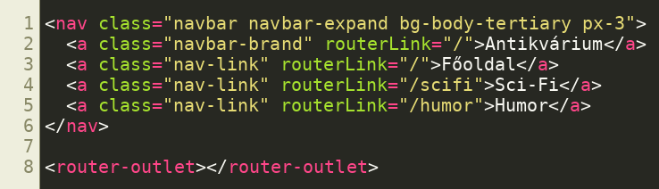

**Fájlok:** `components/xyz/...`, `app-routing.module.ts`, `app.component.html` (vagy nav)

1. `ng g c components/list --skip-tests`   (a `--skip-tests` nem készít teszt fájlt; az `app.module.ts`-be felveszi magától)
2. `app-routing.module.ts`: `{ path: "list", component: ListComponent },`  (az import a fájl tetejére: VS Code felajánlja, vagy írd be)
3. egy hely legyen a `<router-outlet></router-outlet>` az `app.component.html`-ben
4. menüpont: `<a routerLink="/list">Lista</a>`  (NEM `href`!)
5. üres cím és ismeretlen cím: `{ path: "", redirectTo: "list", pathMatch: "full" }` és a legvégén `{ path: "**", redirectTo: "list", pathMatch: "full" }`

**Teszt:** link kattintás -> az oldal tartalma jelenik meg, az oldal nem tölt újra.
**Hiba:** `is not a known element` -> a komponens nincs az `app.module.ts` `declarations`-ben.

**`app/app-routing.module.ts`**
```ts
import { NgModule } from '@angular/core';
import { RouterModule, Routes } from '@angular/router';
import { ListComponent } from './components/list/list.component';
import { CreateComponent } from './components/create/create.component';
import { EditComponent } from './components/edit/edit.component';
import { LoginComponent } from './components/login/login.component';
import { SzuloComponent } from './components/szulo/szulo.component';
import { KonyvUrlapComponent } from './components/konyv-urlap/konyv-urlap.component';

const routes: Routes = [
  { path: "", redirectTo: "list", pathMatch: "full" },    // üres cím -> átirányítás a listára
  { path: "list", component: ListComponent },
  { path: "create", component: CreateComponent },
  { path: "edit/:id", component: EditComponent },         // :id = paraméter (az edit komponens olvassa ki)
  { path: "login", component: LoginComponent },
  { path: "szulo", component: SzuloComponent },
  { path: "konyvek", component: KonyvUrlapComponent },
  { path: "**", redirectTo: "list", pathMatch: "full" },  // ismeretlen cím -> lista
];

@NgModule({
  imports: [RouterModule.forRoot(routes)],
  exports: [RouterModule]
})
export class AppRoutingModule { }
```

**`components/nav/nav.component.html`**
```html
<nav class="navbar navbar-expand-md bg-body-tertiary">
  <div class="container-fluid">
    <a class="navbar-brand" routerLink="/">Márkanév</a>
    <button class="navbar-toggler" type="button" data-bs-toggle="collapse" data-bs-target="#menu">
      <span class="navbar-toggler-icon"></span>
    </button>
    <div class="collapse navbar-collapse" id="menu">
      <ul class="navbar-nav">
        <li class="nav-item"><a class="nav-link" routerLink="/list">Lista</a></li>
        <li class="nav-item" *ngIf="authService.isLoggedIn()"><a class="nav-link" routerLink="/create">Új termék</a></li>
        <li class="nav-item"><a class="nav-link" routerLink="/szulo">Szülő-gyerek</a></li>
        <li class="nav-item"><a class="nav-link" routerLink="/konyvek">Könyvek</a></li>
        <li class="nav-item" *ngIf="!authService.isLoggedIn()"><a class="nav-link" routerLink="/login">Login</a></li>
        <li class="nav-item" *ngIf="authService.isLoggedIn()"><a class="nav-link" (click)="authService.logout()">Logout</a></li>
      </ul>
    </div>
  </div>
</nav>
```

**`app/app.component.html`**
```html
<app-nav></app-nav>

<div class="container mt-4">
  <router-outlet></router-outlet>

  <hr>
  <app-termekajanlo nev="Espresso" [ar]="700"></app-termekajanlo>
  <app-termekajanlo nev="Flat white" [ar]="850" [akcio]="true"></app-termekajanlo>
</div>
```
**Az aloldalak tartalma (a feladat txt fájljából másold a szöveget):**
```html
<!-- egy bekezdés -->
<p>Szöveg...</p>

<!-- sorszámozás nélküli lista (az <ol> a számozott) -->
<ul>
  <li>Első</li>
  <li>Második</li>
</ul>

<!-- táblázat, az első sor címsor -->
<table class="table">
  <thead><tr><th>Cím</th><th>Ár</th></tr></thead>
  <tbody>
    <tr><td>Alma</td><td>450 Ft</td></tr>
  </tbody>
</table>
```

[↑ vissza a tartalomjegyzékhez](#tartalomjegyzék)

---

<a name="k14"></a>

## K14 Widget paraméterrel (@Input), akcio class, három példány

**Jelek a feladatban:** új komponens X néven, widget, bárhol elhelyezhető, @Input, paraméter, opcionális, alapértéke false, akcio, név 3-as szintű címsor, ár bekezdés, class rákerül, három példány a fő komponensben, félkövér, kis-nagybetűs használata, boolean paraméter, mitől lesz true, feltételes class (K39)

> **Boolean paraméter és feltételes class:** az `akcio` alapértéke `false` (kikapcsolt), igazra a használó állítja: `[akcio]="true"`; az ár bekezdése csak igaz esetén kapja a class-t: `[class.akcio]="akcio"`. Részletek és a három mód: **K39**.


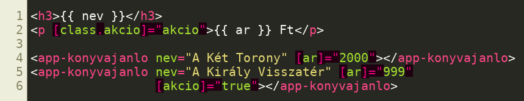

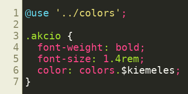

**Mikor:** "új komponens X néven", paraméterek, opcionális alapérték, akciós class.
**Fájlok:** `components/termekajanlo/*`, `_colors.scss`, `app.component.html`

1. `ng g c components/termekajanlo --skip-tests`  (fájl: `termekajanlo.component.ts`, osztály: `TermekajanloComponent`, selector: `app-termekajanlo`)
2. `.ts`: `import { Component, Input } from '@angular/core'`
3. `@Input() nev: string = ""`, `@Input() ar: number = 0`, `@Input() akcio: boolean = false`  (az alapérték teszi opcionálissá)
4. `.html`: `<h3>{{ nev }}</h3>` és `<p [class.akcio]="akcio">{{ ar }} Ft</p>`
5. `src/app/_colors.scss`: `$kiemeles: #b5651d;`
6. `termekajanlo.component.scss`: `@use '../../colors';` majd `.akcio { font-weight: bold; font-size: 1.4rem; color: colors.$kiemeles; }`
7. használat az `app.component.html`-ben: `<app-termekajanlo nev="Latte" [ar]="900" [akcio]="true"></app-termekajanlo>`  (szöveg: zárójel nélkül, szám és igaz/hamis: `[ ]`)

**Teszt:** az akciós ár félkövér, nagyobb, színes; a nem akciós sima.
**Hiba:** az `@use` hibát ad -> az út rossz: a fájltól számítva `../../colors` (két szint), nem `../colors`.

**Elnevezés (a keretrendszer szabálya):** `ng g c termekajanlo` -> fájl `termekajanlo.component.ts`, osztály `TermekajanloComponent`, selector `app-termekajanlo`; a paraméterek camelCase (`@Input() nev`).

**`termekajanlo.component.ts`**
```ts
import { Component, Input } from '@angular/core';

@Component({
  selector: 'app-termekajanlo',
  templateUrl: './termekajanlo.component.html',
  styleUrl: './termekajanlo.component.scss'
})
export class TermekajanloComponent {
  @Input() nev: string = ""             // kötelező jellegű (nincs értelmes alapértéke)
  @Input() ar: number = 0
  @Input() akcio: boolean = false       // OPCIONÁLIS: az alapérték miatt nem kell megadni
}
```

**`termekajanlo.component.html`**
```html
<h3>{{ nev }}</h3>
<p [class.akcio]="akcio">{{ ar }} Ft</p>
```

**`termekajanlo.component.scss`**
```scss
@use '../../colors';           // a _colors.scss fájlhoz vezető út ettől a fájltól számítva: ../../ = két szinttel feljebb (src/app/_colors.scss)
                               // az aláhúzás és a .scss kimarad. Ha a komponens közvetlenül az app/ alatt van: '../colors'

.akcio {
  font-weight: bold;           // félkövér
  font-size: 1.4rem;           // nagyobb betűméret
  color: colors.$kiemeles;     // colors. + a változó neve
}
```

**`src/app/_colors.scss`**
```scss
$kiemeles: #b5651d;
$szurke: #666666;
```
**Használat a fő komponens html-jében (tesztelési célból három példány):**
```html
<app-termekajanlo nev="Espresso" [ar]="700"></app-termekajanlo>
<app-termekajanlo nev="Latte" [ar]="900"></app-termekajanlo>
<app-termekajanlo nev="Flat white" [ar]="850" [akcio]="true"></app-termekajanlo>
```
Szöveg: `nev="..."` szögletes zárójel nélkül; szám és igaz/hamis: `[ar]="700"`, `[akcio]="true"`.

[↑ vissza a tartalomjegyzékhez](#tartalomjegyzék)

---

<a name="k15"></a>

## K15 Szülő-gyerek komponens (@Output)

**Jelek a feladatban:** a gyerek értesíti a szülőt, @Output, EventEmitter, komponensek közti kommunikáció, gombnyomásra a szülő tudjon róla


1. `ng g c components/gyerek --skip-tests` és `ng g c components/szulo --skip-tests`
2. gyerek `.ts`: `@Input() item: Product = new Product()` és `@Output() message: EventEmitter<Product> = new EventEmitter<Product>()`
3. import: `import { Component, EventEmitter, Input, Output } from '@angular/core'`
4. gyerek metódus: `hello(): void { this.message.emit(this.item) }`, html: `<button (click)="hello()">`
5. szülő html: `<app-gyerek *ngFor="let p of service.products" [item]="p" (message)="onMessage($event)"></app-gyerek>`
6. szülő `.ts`: `onMessage(product: Product): void { ... }`

**Teszt:** a gyerek gombjára a szülő metódusa lefut (F12 konzol).

**`gyerek.component.ts`**
```ts
import { Component, EventEmitter, Input, Output } from '@angular/core';
import { Product } from '../../models/product';

@Component({
  selector: 'app-gyerek',
  templateUrl: './gyerek.component.html'
})
export class GyerekComponent {
  @Input() item: Product = new Product()                                       // szülő -> gyerek
  @Output() message: EventEmitter<Product> = new EventEmitter<Product>()       // gyerek -> szülő

  hello(): void {
    this.message.emit(this.item)        // elküldi a szülőnek
  }
}
```

**`gyerek.component.html`**
```html
<div>
  <h5>{{ item.name }}</h5>
  <button class="btn btn-sm btn-primary" (click)="hello()">Szólj a szülőnek</button>
</div>
```

**`szulo.component.ts`**
```ts
import { Component } from '@angular/core';
import { Product } from '../../models/product';
import { ProductService } from '../../services/product.service';

@Component({
  selector: 'app-szulo',
  templateUrl: './szulo.component.html'
})
export class SzuloComponent {
  last: string = ""

  constructor(public service: ProductService) { }

  onMessage(product: Product): void {      // a gyerek eseménye ide érkezik ($event = amit a gyerek emit-elt)
    this.last = product.name
  }
}
```

**`szulo.component.html`**
```html
<!-- [item]="p"  = adat a gyereknek;   (message)="onMessage($event)" = esemény a gyerektől -->
<p>Utolsó kattintás: {{ last }}</p>
<app-gyerek *ngFor="let p of service.products" [item]="p" (message)="onMessage($event)"></app-gyerek>
```

[↑ vissza a tartalomjegyzékhez](#tartalomjegyzék)

---

# D. Angular adat, tárolás, login

<a name="k16"></a>

## K16 Model + service + lista oldal

**Jelek a feladatban:** osztály / modell, service, lista tárolása, create / read / update / delete, ngFor, táblázat a listából, forint formátum, currency, induló adatok (seed)


**Fájlok:** `models/product.ts`

1. `ng g class models/product`  (a fájl neve `product.ts`, az osztály `Product`)
2. mezők alapértékkel: `id: number = 0`, `name: string = ""`, `price: number = 0`
3. kell konstruktor? `constructor(name: string = "", price: number = 0) { this.name = name; this.price = price }`
4. kell metódus? `toString(): string { return ... }`
5. használat máshol: `import { Product } from '../models/product'` és `new Product()`

**Hiba:** `new Product()` után a mezők `undefined` -> nincs alapérték a mezőnél.

**Mikor:** "a lista tárolása", több oldal használja ugyanazt az adatot.
**Fájlok:** `services/product.service.ts`, `components/list/list.component.ts|html`

1. `ng g s services/product --skip-tests`
2. a service-ben: `products: Product[] = []` és `private nextId: number = 1`
3. `create(product)`: `product.id = this.nextId++; this.products.push(product)`
4. `getById(id)`: `return this.products.find(x => x.id === id)`
5. `update(product)`: `findIndex` + `this.products[index] = product`
6. `delete(product)`: `this.products = this.products.filter(x => x.id !== product.id)`
7. a `constructor()`-ban néhány induló elem (seed)
8. `list.component.ts`: `constructor(public service: ProductService) { }`  (a `public` kell, hogy a html is lássa)
9. `list.component.html`: `<tr *ngFor="let p of service.products">` + `{{ p.name }}` + `{{ p.price | currency: 'HUF':'symbol':'1.0-0':'hu-HU' }}`
10. a forint formátumhoz az `app.module.ts`-ben: `registerLocaleData(localeHu)` (K16 (app.module.ts))

**Teszt:** a lista kirajzolja az induló elemeket.
**Hiba:** a html nem látja a service-t -> a konstruktorban `private` van `public` helyett.

**`models/product.ts`**
```ts
export class Product {
    id: number = 0
    name: string = ""
    price: number = 0
    akcio: boolean = false

    // konstruktor = összeszerelő munkás: a kapott alkatrészeket beírja az új objektumba
    constructor(name: string = "", price: number = 0, akcio: boolean = false) {
        this.name = name
        this.price = price
        this.akcio = akcio
    }

    getFormattedPrice(): string {
        return this.price.toLocaleString("hu-HU") + " Ft"
    }

    // toString: ezt hívja a kiírás ({{ p }} vagy console.log)
    toString(): string {
        return `${this.name} (${this.price})`
    }
}
```

**`services/product.service.ts`**
```ts
import { Injectable } from '@angular/core';
import { Product } from '../models/product';

@Injectable({ providedIn: 'root' })        // root = az egész app ugyanazt a példányt használja
export class ProductService {
  products: Product[] = []
  private nextId: number = 1

  constructor() {
    this.seed("Espresso", 700, false)      // induló adatok
    this.seed("Latte", 900, true)
    this.seed("Cappuccino", 850, false)
  }

  create(product: Product): void {
    product.id = this.nextId++
    this.products.push(product)
  }

  getById(id: number): Product | undefined {
    return this.products.find(x => x.id === id)
  }

  update(product: Product): void {
    let index = this.products.findIndex(x => x.id === product.id)
    this.products[index] = product
  }

  delete(product: Product): void {
    this.products = this.products.filter(x => x.id !== product.id)    // új tömb: a törlendő nélkül
  }

  private seed(name: string, price: number, akcio: boolean): void {
    this.create(new Product(name, price, akcio))
  }
}
```

**`components/list/list.component.ts`**
```ts
import { Component } from '@angular/core';
import { ProductService } from '../../services/product.service';
import { Product } from '../../models/product';

@Component({
  selector: 'app-list',
  templateUrl: './list.component.html'
})
export class ListComponent {
  search: string = ""

  // public: a sablon (html) is lássa a service-t
  constructor(public service: ProductService) { }

  // szűrt lista: csak amiben szerepel a keresett szöveg (kis/nagybetű nem számít)
  get filtered(): Product[] {
    return this.service.products.filter(x => x.name.toLowerCase().includes(this.search.toLowerCase()))
  }
}
```

**`components/list/list.component.html`**
```html
<h4>Termékek</h4>

<input class="form-control mb-2" [(ngModel)]="search" placeholder="Keresés..." type="text">

<div class="alert alert-info" *ngIf="service.products.length === 0">Nincs adat.</div>

<table class="table table-striped" *ngIf="service.products.length > 0">
  <thead>
    <tr><th>#</th><th>Név</th><th>Ár</th><th>Akció</th><th></th></tr>
  </thead>
  <tbody>
    <tr *ngFor="let p of filtered; index as i">
      <td>{{ i + 1 }}</td>
      <td>{{ p.name }}</td>
      <td>{{ p.price | currency: 'HUF':'symbol':'1.0-0':'hu-HU' }}</td>
      <td>{{ p.akcio ? 'igen' : 'nem' }}</td>
      <td>
        <button class="btn btn-sm btn-warning me-1" routerLink="/edit/{{ p.id }}">Szerkeszt</button>
        <button class="btn btn-sm btn-danger" (click)="service.delete(p)">Töröl</button>
      </td>
    </tr>
  </tbody>
</table>
```

**`app.module.ts` (komponensek, `FormsModule`, `HttpClientModule`, forint formátum):**

**`app/app.module.ts`**
```ts
import { NgModule } from '@angular/core';
import { BrowserModule } from '@angular/platform-browser';
import { FormsModule } from '@angular/forms';                    // [(ngModel)] miatt
import { HttpClientModule } from '@angular/common/http';         // http.get/post miatt
import { registerLocaleData } from '@angular/common';
import localeHu from '@angular/common/locales/hu';               // forint formázás (currency pipe)

import { AppRoutingModule } from './app-routing.module';
import { AppComponent } from './app.component';
import { NavComponent } from './components/nav/nav.component';
import { ListComponent } from './components/list/list.component';
import { CreateComponent } from './components/create/create.component';
import { EditComponent } from './components/edit/edit.component';
import { LoginComponent } from './components/login/login.component';
import { TermekajanloComponent } from './components/termekajanlo/termekajanlo.component';
import { SzuloComponent } from './components/szulo/szulo.component';
import { GyerekComponent } from './components/gyerek/gyerek.component';
import { KonyvUrlapComponent } from './components/konyv-urlap/konyv-urlap.component';

registerLocaleData(localeHu)

@NgModule({
  declarations: [
    AppComponent, NavComponent, ListComponent, CreateComponent, EditComponent,
    LoginComponent, TermekajanloComponent, SzuloComponent, GyerekComponent, KonyvUrlapComponent
  ],
  imports: [BrowserModule, AppRoutingModule, FormsModule, HttpClientModule],
  providers: [],
  bootstrap: [AppComponent]
})
export class AppModule { }
```

[↑ vissza a tartalomjegyzékhez](#tartalomjegyzék)

---

<a name="k17"></a>

## K17 Új elem űrlapról: validáció, gomb tiltás, lista tárolása, "tegye interaktívvá"

**Jelek a feladatban:** űrlap, új elem hozzáadása, gomb tiltása, ngModel, validáció, tegye interaktívvá, a fő komponens tárolja a listát, a lista végéhez, a form ürítése, kivétellel jelezze a hibát


**Fájlok:** `app.module.ts`, `components/create/*`

1. `app.module.ts` `imports`: `FormsModule` (`import { FormsModule } from '@angular/forms'`)
2. `ng g c components/create --skip-tests`, útvonal `create`, menüpont (K13)
3. `create.component.ts`: `product: Product = new Product()` és `constructor(private router: Router, private service: ProductService) { }`
4. `create.component.html`: `<input [(ngModel)]="product.name" placeholder="Név..." type="text">` (minden mezőre)
5. `buttonDisabled(): boolean`: `if (this.product.name.length < 3) return true` ... végén `return false`
6. a gomb: `<button (click)="create()" [disabled]="buttonDisabled()">Mentés</button>`
7. `create(): void { this.service.create(this.product); this.router.navigateByUrl("list") }`

**Teszt:** üres mezőknél a gomb szürke; mentés után a listában ott az elem.
**Hiba:** `Can't bind to 'ngModel'` -> 1. lépés kimaradt.

**`components/create/create.component.ts`**
```ts
import { Component } from '@angular/core';
import { Router } from '@angular/router';
import { Product } from '../../models/product';
import { ProductService } from '../../services/product.service';

@Component({
  selector: 'app-create',
  templateUrl: './create.component.html'
})
export class CreateComponent {
  product: Product = new Product()          // ebbe ír az űrlap ([(ngModel)])

  constructor(private router: Router, private service: ProductService) { }

  buttonDisabled(): boolean {               // true = a gomb tiltva van
    if (this.product.name.length < 3) return true
    if (this.product.price < 100) return true
    return false
  }

  create(): void {
    this.service.create(this.product)
    this.router.navigateByUrl("list")       // mentés után a lista oldalra
  }
}
```

**`components/create/create.component.html`**
```html
<h4>Új termék</h4>

<input class="form-control mb-2" [(ngModel)]="product.name" placeholder="Név..." type="text">
<input class="form-control mb-2" [(ngModel)]="product.price" placeholder="Ár..." type="number">

<div class="form-check mb-2">
  <input class="form-check-input" type="checkbox" id="akcio" [(ngModel)]="product.akcio">
  <label class="form-check-label" for="akcio">Akciós</label>
</div>

<button class="btn btn-success" (click)="create()" [disabled]="buttonDisabled()">Mentés</button>
```

**Ha a feladat "a fő komponens tárolja a listát, a form ürül, hibás adatnál kivétel" (a mintalap 5. feladata):**

**`models/konyv.ts`**
```ts
export class Konyv {
    #cim: string
    #isbn: string

    constructor(cim: string, isbn: string) {
        if (cim.trim().length === 0) {
            throw new Error("A cím nem lehet üres!")
        }
        if (isbn.length !== 10 && isbn.length !== 13) {
            throw new Error("Az ISBN 10 vagy 13 karakter legyen!")
        }
        if (![...isbn].every(c => c >= "0" && c <= "9")) {
            throw new Error("Az ISBN csak számjegyet tartalmazhat!")
        }
        this.#cim = cim
        this.#isbn = isbn
    }

    get cim(): string { return this.#cim }
    get isbn(): string { return this.#isbn }

    toString(): string {
        return `${this.#cim} (${this.#isbn})`
    }
}
```

**`components/konyv-urlap/konyv-urlap.component.ts`**
```ts
import { Component } from '@angular/core';
import { Konyv } from '../../models/konyv';

@Component({
  selector: 'app-konyv-urlap',
  templateUrl: './konyv-urlap.component.html'
})
export class KonyvUrlapComponent {
  cim: string = ""                 // az űrlap mezői ([(ngModel)])
  isbn: string = ""
  konyvek: Konyv[] = []            // a lista tárolása
  hiba: string = ""

  add(): void {
    try {
      this.konyvek.push(new Konyv(this.cim, this.isbn))    // hozzáadás a lista VÉGÉHEZ
      this.cim = ""                                         // az űrlap ürítése (csak siker esetén)
      this.isbn = ""
      this.hiba = ""
    } catch (error) {
      this.hiba = (error as Error).message                  // a hibás adatnál a konstruktor kivételt dob; a lista nem változik
    }
  }
}
```

**`components/konyv-urlap/konyv-urlap.component.html`**
```html
<h4>Új könyv</h4>

<input class="form-control mb-2" [(ngModel)]="cim" placeholder="Cím..." type="text">
<input class="form-control mb-2" [(ngModel)]="isbn" placeholder="ISBN (10 vagy 13 számjegy)..." type="text">
<button class="btn btn-success" (click)="add()">Hozzáad</button>

<div class="alert alert-danger mt-2" *ngIf="hiba !== ''">{{ hiba }}</div>

<ul class="mt-3">
  <li *ngFor="let k of konyvek">{{ k.toString() }}</li>
</ul>
```

[↑ vissza a tartalomjegyzékhez](#tartalomjegyzék)

---

<a name="k18"></a>

## K18 Törlés, szerkesztés (edit/:id), keresés

**Jelek a feladatban:** törlés gomb, szerkesztés, szerkesztő oldal, edit/:id, ActivatedRoute, útvonal paraméter, keresés, szűrés, másolat, Object.assign


1. a service-ben `delete(product)` már megvan (K16, a `filter`-es)
2. `list.component.html`: `<button (click)="service.delete(p)">Töröl</button>` a sorban
3. ha csak belépve lehet törölni: `*ngIf="authService.isLoggedIn()"` (K22)

**Teszt:** a sor eltűnik, a többi marad.
**Hiba:** nem tűnik el -> a `filter` eredményét nem tetted vissza a változóba (`this.products = this.products.filter(...)`).

**Fájlok:** `components/edit/*`, `app-routing.module.ts`, `list.component.html`

1. `ng g c components/edit --skip-tests`
2. útvonal: `{ path: "edit/:id", component: EditComponent }`
3. a lista soraiban: `<button routerLink="/edit/{{ p.id }}">Szerkeszt</button>`
4. `edit.component.ts` konstruktor: `constructor(private route: ActivatedRoute, private router: Router, private service: ProductService)`
5. a konstruktorban: `route.params.subscribe(x => { let id = Number(x['id']); let result = this.service.getById(id); ... })`
6. ha `result === undefined` -> `this.router.navigateByUrl("list")`, különben `this.product = Object.assign(new Product(), result)`  (**másolat!**)
7. `update(): void { this.service.update(this.product); this.router.navigateByUrl("list") }`
8. html: mint a `create`, a gomb az `update()`-et hívja

**Teszt:** szerkeszd az elemet: mentésig a lista nem változik, mentés után igen.
**Hiba:** gépelés közben már változik a lista -> a másolat (`Object.assign`) kimaradt.

1. `list.component.ts`: `search: string = ""`
2. `get filtered(): Product[] { return this.service.products.filter(x => x.name.toLowerCase().includes(this.search.toLowerCase())) }`
3. `list.component.html`: `<input [(ngModel)]="search" placeholder="Keresés...">`
4. a táblázatban `*ngFor="let p of filtered"` (a `service.products` helyett)

**Teszt:** gépelésre szűkül a lista.

**`components/edit/edit.component.ts`**
```ts
import { Component } from '@angular/core';
import { ActivatedRoute, Router } from '@angular/router';
import { Product } from '../../models/product';
import { ProductService } from '../../services/product.service';

@Component({
  selector: 'app-edit',
  templateUrl: './edit.component.html'
})
export class EditComponent {
  product: Product = new Product()

  constructor(private route: ActivatedRoute, private router: Router, private service: ProductService) {
    route.params.subscribe(x => {
      let id: number = Number(x['id'])                       // az útvonal paramétere mindig szöveg: Number()
      let result: Product | undefined = this.service.getById(id)
      if (result === undefined) this.router.navigateByUrl("list")           // nincs ilyen elem -> vissza
      else this.product = Object.assign(new Product(), result)              // MÁSOLAT: mentésig nem változik a lista
    })
  }

  update(): void {
    this.service.update(this.product)
    this.router.navigateByUrl("list")
  }
}
```

**`components/edit/edit.component.html`**
```html
<!-- A create.component.html-hez hasonló űrlap; a gomb az update()-et hívja. -->
<h4>Termék szerkesztése</h4>

<input class="form-control mb-2" [(ngModel)]="product.id" disabled type="text">
<input class="form-control mb-2" [(ngModel)]="product.name" placeholder="Név..." type="text">
<input class="form-control mb-2" [(ngModel)]="product.price" placeholder="Ár..." type="number">

<div class="form-check mb-2">
  <input class="form-check-input" type="checkbox" id="akcio2" [(ngModel)]="product.akcio">
  <label class="form-check-label" for="akcio2">Akciós</label>
</div>

<button class="btn btn-warning" (click)="update()">Mentés</button>
```
A törlés, a szerkesztés link és a keresés a **K16** `list.component.html` / `.ts` fájljában van (`service.delete(p)`, `routerLink="/edit/{{ p.id }}"`, `filtered`).

[↑ vissza a tartalomjegyzékhez](#tartalomjegyzék)

---

<a name="k19"></a>

## K19 Statisztika: átlag, legnagyobb, legkisebb, darabszám

**Jelek a feladatban:** átlagár, legdrágább, legolcsóbb, hány akciós, statisztika, reduce

1. `ng g s services/statistics --skip-tests`, konstruktor: `constructor(private service: ProductService) { }`
2. `averagePrice()`: `if (len === 0) return 0`, majd `reduce((a, x) => a + x.price, 0) / length`, `Math.round`
3. `mostExpensive()`: `reduce((a, b) => a.price < b.price ? b : a)`, `cheapest()` ugyanígy fordítva
4. darabszám feltétellel: `filter(x => x.akcio).length`
5. komponensben `constructor(public statService: StatisticsService)`, html: `{{ statService.averagePrice() }}`

**`services/statistics.service.ts`**
```ts
import { Injectable } from '@angular/core';
import { Product } from '../models/product';
import { ProductService } from './product.service';

@Injectable({ providedIn: 'root' })
export class StatisticsService {

  constructor(private service: ProductService) { }

  get products(): Product[] {
    return this.service.products
  }

  averagePrice(): number {
    if (this.products.length === 0) return 0                          // üres listánál ne legyen 0-val osztás
    let sum = this.products.reduce((a, x) => a + x.price, 0)          // reduce = összeadogató
    return Math.round(sum / this.products.length)
  }

  mostExpensive(): Product | null {
    if (this.products.length === 0) return null
    return this.products.reduce((a, b) => a.price < b.price ? b : a)  // a nagyobbat viszi tovább
  }

  cheapest(): Product | null {
    if (this.products.length === 0) return null
    return this.products.reduce((a, b) => a.price < b.price ? a : b)  // a kisebbet viszi tovább
  }

  akcioCount(): number {
    return this.products.filter(x => x.akcio).length                  // hány elemre igaz a feltétel
  }
}
```

[↑ vissza a tartalomjegyzékhez](#tartalomjegyzék)

---

<a name="k20"></a>

## K20 Mentés újratöltés után (localStorage)

**Jelek a feladatban:** mentse el, újratöltés után is maradjon, tárolja a böngészőben, localStorage, JSON.stringify, JSON.parse, kulcs


1. a service-ben: `private key: string = "products"`
2. `private save(): void { localStorage.setItem(this.key, JSON.stringify(this.products)) }`
3. `private load(): void { let data = JSON.parse(localStorage.getItem(this.key) ?? "[]"); this.products = data.map((x: any) => Object.assign(new Product(), x)) }`
4. a `constructor()`-ban: `this.load()`
5. minden módosító metódus (create, update, delete) VÉGÉN: `this.save()`
6. a `nextId` legyen a legnagyobb meglévő id + 1 (kész kód: `angular-minta/src/app/services/product.service.localstorage.ts`)

**Teszt:** vegyél fel elemet, nyomj F5-öt: az elem megmarad. F12 > Application > Local Storage: ott a kulcs.
**Hiba:** privát `#` mezős osztálynál a `JSON.stringify` üres objektumot ad: kézzel képezd le (`{ nev: x.nev }`) és `new Osztaly(x.nev)`-vel olvasd vissza.

**`services/product.service.ts (localStorage változat: ezt másold a service helyére)`**
```ts
import { Injectable } from '@angular/core';
import { Product } from '../models/product';

@Injectable({ providedIn: 'root' })
export class ProductService {
  products: Product[] = []
  private nextId: number = 1
  private key: string = "products"           // a "zseb" neve a localStorage-ban

  constructor() {
    this.load()                              // induláskor: betöltés
  }

  create(product: Product): void {
    product.id = this.nextId++
    this.products.push(product)
    this.save()                              // minden módosítás után: mentés
  }

  getById(id: number): Product | undefined {
    return this.products.find(x => x.id === id)
  }

  update(product: Product): void {
    let index = this.products.findIndex(x => x.id === product.id)
    this.products[index] = product
    this.save()
  }

  delete(product: Product): void {
    this.products = this.products.filter(x => x.id !== product.id)
    this.save()
  }

  private save(): void {
    localStorage.setItem(this.key, JSON.stringify(this.products))   // lista -> szöveg
  }

  private load(): void {
    let data = JSON.parse(localStorage.getItem(this.key) ?? "[]")   // szöveg -> sima objektumok (?? "[]": ha nincs mentés)
    this.products = data.map((x: any) => Object.assign(new Product(), x))   // vissza Product példányokra
    this.nextId = this.products.length === 0 ? 1 : Math.max(...this.products.map(x => x.id)) + 1
  }
}
```

[↑ vissza a tartalomjegyzékhez](#tartalomjegyzék)

---

<a name="k21"></a>

## K21 Adat szerverről: HttpClient (get / post / put / delete)

**Jelek a feladatban:** szerverről, API, végpont, HttpClient, get, post, put, delete, subscribe, next, error, Network fül


1. `app.module.ts` `imports`: `HttpClientModule`
2. a service-ben: `constructor(private http: HttpClient) { this.read() }`
3. `read(): void { this.http.get<Product[]>(url).subscribe(data => { this.products = data.map(x => Object.assign(new Product(), x)) }) }`
4. új elem: `this.http.post(url, product).subscribe({ next: r => { this.products.push(product) }, error: e => console.log(e) })`
5. módosítás: `this.http.put(url, product)`, törlés: `this.http.delete(url, { body: { id: product.id } })`

**Teszt:** F12 > Network fül: látod a kérést és a választ.
**Hiba:** `No provider for HttpClient` -> `HttpClientModule` hiányzik.

```ts
constructor(private http: HttpClient) { this.read() }

read(): void {
  this.http.get<Product[]>("https://api.valami.hu/products").subscribe(data => {
    this.products = data.map(x => Object.assign(new Product(), x))
  })
}

create(product: Product): void {
  this.http.post("https://api.valami.hu/products", product).subscribe({
    next: response => { console.log(response); this.products.push(product) },
    error: error => { console.log(error) }
  })
}

update(product: Product): void {
  this.http.put("https://api.valami.hu/products", product).subscribe({
    next: response => {
      let index = this.products.findIndex(x => x.id === product.id)
      this.products[index] = product
    },
    error: error => { console.log(error) }
  })
}

delete(product: Product): void {
  this.http.delete("https://api.valami.hu/products", { body: { id: product.id } }).subscribe({
    next: response => { this.products = this.products.filter(x => x.id !== product.id) },
    error: error => { console.log(error) }
  })
}
```

[↑ vissza a tartalomjegyzékhez](#tartalomjegyzék)

---

<a name="k22"></a>

## K22 LOGIN / LOGOUT (token)

**Jelek a feladatban:** login, bejelentkezés, token, kijelentkezés, logout, be van-e lépve, isLoggedIn, csak belépve látszik, AuthService, LoginModel, TokenModel, localStorage token, védett menüpont


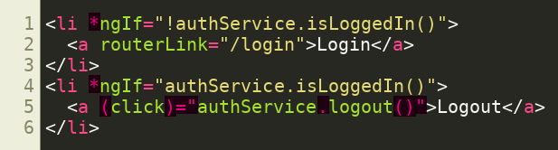

**Mikor:** bejelentkezés, "csak belépve látszódjon", kijelentkezés.
**Fájlok:** `models/login-model.ts`, `models/token-model.ts`, `services/auth.service.ts`, `components/login/*`, `components/nav/*`

1. `ng g s services/auth --skip-tests`
2. `ng g class models/login-model` -> a fájlban: `username: string = ""` és `password: string = ""`
3. `ng g class models/token-model` -> `token: string = ""`  (**class**, NEM `ng g c`: az komponenst csinálna)
4. `app.module.ts` `imports`: `FormsModule` és `HttpClientModule`
5. `auth.service.ts`: `constructor(private http: HttpClient, private router: Router) { }`
6. először `any`-vel: `login(loginModel: LoginModel): void { this.http.post<any>("https://api.valami.hu/login", loginModel).subscribe({ next: response => { console.log(response) }, error: error => { console.log(error) } }) }`
7. `ng g c components/login --skip-tests`, útvonal `login`, menüpont a navban
8. `login.component.ts`: `loginModel: LoginModel = new LoginModel()` és `constructor(public authService: AuthService) { }`
9. `login.component.html`: `<input [(ngModel)]="loginModel.username">`, `<input type="password" [(ngModel)]="loginModel.password">`, `<button (click)="authService.login(loginModel)">Belépés</button>`
10. **F12 teszt:** írd be a felhasználót és a jelszót, katt a gombra -> a konzolon látszik a válasz (milyen mezőben jön a token?)
11. az `any` cseréje: `this.http.post<TokenModel>(...)` (a `TokenModel` mezője legyen az, amit a konzol mutatott)
12. a `next` ágban: `this.saveToken(response.token)` és utána `this.router.navigateByUrl("list")`
13. lejjebb a service-ben: `saveToken(token: string): void { localStorage.setItem("auth-token", token) }`
14. `removeToken(): void { localStorage.removeItem("auth-token"); this.router.navigateByUrl("login") }`
15. `logout(): void { this.removeToken() }`  (a logout valójában csak törli a tokent)
16. `getToken(): string { return localStorage.getItem("auth-token") ?? "" }`
17. `isLoggedIn(): boolean { return this.getToken().length > 10 }`
18. `nav.component.ts`: `constructor(public authService: AuthService) { }`
19. `nav.component.html`: a Login menüpontra `*ngIf="!authService.isLoggedIn()"`
20. a Logout menüpontra `*ngIf="authService.isLoggedIn()"` és `(click)="authService.logout()"`  (nem útvonal: kattintásra fut a metódus)
21. védett menüpontok (create, delete): `*ngIf="authService.isLoggedIn()"`

**Teszt:** belépés előtt Login látszik, utána Logout + a védett menüpontok; kilépés után vissza.
**Hiba:** `response.token` undefined -> a válasz mezője másképp hívják: nézd a konzolt, írd át a `TokenModel`-t.
**Hiba:** nem lép be -> a `LoginModel` mezői nem azt a nevet viselik, amit az API vár.

**Hétköznapi hasonlat:** a pénztárnál (a login URL) megmutatod az adataidat -> kapsz egy karszalagot (token) -> elteszed a zsebedbe (localStorage) -> amíg van karszalag, "be vagy lépve" -> kilépés = a karszalag eldobása.

**`models/login-model.ts`**
```ts
export class LoginModel {
    username: string = ""
    password: string = ""
}
```

**`models/token-model.ts`**
```ts
export class TokenModel {
    token: string = ""
}
```

**`services/auth.service.ts`**
```ts
import { HttpClient } from '@angular/common/http';
import { Injectable } from '@angular/core';
import { Router } from '@angular/router';
import { LoginModel } from '../models/login-model';
import { TokenModel } from '../models/token-model';

@Injectable({ providedIn: 'root' })
export class AuthService {

  // HttpClient = kérések küldése; Router = oldalváltás (a konstruktorban kérjük el)
  constructor(private http: HttpClient, private router: Router) { }

  login(loginModel: LoginModel): void {
    this.http.post<TokenModel>("https://api.valami.hu/login", loginModel).subscribe({
      next: response => {
        console.log(response)                                  // ELSŐ LÉPÉS: nézd meg, milyen alakú a válasz
        localStorage.setItem("auth-token", response.token)     // a karszalag elmentése
        this.router.navigateByUrl("list")                      // belépés után a listára
      },
      error: error => {
        console.log(error)                                     // rossz adat esetén ide jön
      }
    })
  }

  logout(): void {
    localStorage.removeItem("auth-token")                      // karszalag eldobása
    this.router.navigateByUrl("login")
  }

  getToken(): string {
    return localStorage.getItem("auth-token") ?? ""            // ?? "" = ha nincs, üres szöveg
  }

  isLoggedIn(): boolean {
    return this.getToken().length > 10                         // hosszú szöveg = van token
  }
}
```

**`components/login/login.component.ts`**
```ts
import { Component } from '@angular/core';
import { LoginModel } from '../../models/login-model';
import { AuthService } from '../../services/auth.service';

@Component({
  selector: 'app-login',
  templateUrl: './login.component.html'
})
export class LoginComponent {
  loginModel: LoginModel = new LoginModel()          // ebbe ír az űrlap

  constructor(public authService: AuthService) { }   // public: a sablon is látja
}
```

**`components/login/login.component.html`**
```html
<h4>Login</h4>
<input class="form-control mb-2" type="text" placeholder="Felhasználónév..." [(ngModel)]="loginModel.username">
<input class="form-control mb-2" type="password" placeholder="Jelszó..." [(ngModel)]="loginModel.password">
<button class="btn btn-success" (click)="authService.login(loginModel)">Belépés</button>
```
**A navbar (`*ngIf` a belépéstől függően) a K13-ban van (`nav.component.html`), a `nav.component.ts`-ben: `constructor(public authService: AuthService) { }`.**

**Ha egy kérés csak belépve működik (a token a fejlécben megy):**
```ts
import { HttpHeaders } from '@angular/common/http';
this.http.delete(url, {
  headers: new HttpHeaders({
    "Content-Type": "application/json",
    "Authorization": "Bearer " + this.authService.getToken()     // "Bearer " + a token
  }),
  body: { id: valami.id }
}).subscribe({ next: r => console.log(r), error: e => console.log(e) })
```

**Más feladatnál mit írsz át:** a login URL; a `LoginModel` mezői (amit az API vár); a `TokenModel` mezője (amit a konzol mutat: `token`/`accessToken`/`jwt`); hova navigáljon belépés után; a `localStorage` kulcs (de mindenhol ugyanaz). A recept ugyanaz marad.

[↑ vissza a tartalomjegyzékhez](#tartalomjegyzék)

---

# E. Beadás, hibák

<a name="k23"></a>

## K23 Git: commit, ág, merge, push

**Jelek a feladatban:** git, commit, push, ág, merge, .gitignore, clone, init, add, beadás, termekajanlo ág, node_modules


1. `git status` (mi változott)
2. `git add .` (minden a "kosárba")
3. `git commit -m "01 feladat kész"`
4. `git push` (első alkalommal: `git push -u origin main`)
5. új ág: `git checkout -b termekajanlo` ... munka, add, commit ... `git checkout main` és `git merge termekajanlo`
6. új repo-nál: `git init`, `git branch -M main`, `echo "node_modules/" >> .gitignore`, `git remote add origin <url>`

**Hiba:** "nothing added to commit" -> kimaradt a `git add .`.
**Hiba:** push `GH007` -> GitHub > Settings > Emails > "Block command line pushes" kikapcsolása.

```bash
git clone https://github.com/felhasznalo/repo.git    # letöltés (a feladat így érkezik)
git status                                           # mi változott, mi van a "kosárban"

git add .                                            # minden változás a kosárba
git commit -m "01 feladat kész"                      # mentés üzenettel (ELŐTTE kell az add!)
git push                                             # feltöltés (első alkalommal: git push -u origin main)

git log                                              # a commitok listája

git checkout -b termekajanlo                         # új ág létrehozása és átlépés rá
# ... munka, add, commit ...
git checkout main                                    # vissza a main ágra
git merge termekajanlo                               # az ág beolvasztása a main-be

git init                                             # új repo (ha nincs még)
git branch -M main                                   # az ág neve main legyen
echo "node_modules/" >> .gitignore                   # ez a mappa ne kerüljön fel (>> = fájl végére fűz)
git remote add origin https://github.com/felhasznalo/repo.git
```

- Git Bash-ben beillesztés: **Shift+Insert** (Ctrl+V nem működik).
- `git commit` után "nothing added to commit" -> elfelejtetted a `git add .`-ot.
- Push hiba `GH007 private email`: GitHub -> Settings -> Emails -> "Block command line pushes that expose my email" kikapcsolása.

[↑ vissza a tartalomjegyzékhez](#tartalomjegyzék)

---

<a name="k24"></a>

## K24 Build + Firebase Hosting

**Jelek a feladatban:** build, ng build, publikálás, Firebase, hosting, firebase deploy, firebase.json, dist, élő oldal, egyoldalas alkalmazás

**Fontos:** a Firebase lépések nem a tanári anyagból valók (ott csak a `firebase.json` fájl van meg), hanem a Firebase szokásos menete. A pontos kimeneti mappát a `ng build` kimenete mutatja.

1. `ng build` (hiba nélkül kell lefutnia; a kimenet: `dist/projekt-neve/browser`)
2. `npm i -g firebase-tools` (egyszer)
3. `firebase login` (Google fiókkal)
4. `firebase init hosting`: projekt választása; **public directory:** `dist/projekt-neve/browser`; single-page app: **Yes** (minden útvonal az `index.html`-re); GitHub-deploy: No
5. `firebase deploy --only hosting`
6. a kiírt "Hosting URL" az élő oldal

**Teszt:** nyisd meg az URL-t; a routing az oldal frissítésekor is működik (ehhez kell az SPA beállítás).
**Hiba:** üres oldal -> a public mappa rossz (nézd meg, hol van az `index.html` a `dist` alatt).

**Adatbázis (Firestore) a tananyagban nem szerepelt.** Ha mégis CRUD-ot kérnek tárolással: a service felépítése ugyanaz (K16), csak a `save()/load()` helyett a szolgáltató hívásai kerülnek bele (K20 és K21 mintája).

```json
{
  "hosting": {
    "public": "dist/projekt-neve/browser",
    "ignore": ["firebase.json", "**/.*", "**/node_modules/**"],
    "rewrites": [
      { "source": "**", "destination": "/index.html" }
    ]
  }
}
```

[↑ vissza a tartalomjegyzékhez](#tartalomjegyzék)

---

<a name="k25"></a>

## K25 Vizsgai induló rutin, tesztek, időbeosztás

**Jelek a feladatban:** vizsga kezdés, hol kezdjem, teszt fájl, spec, automata teszt, nem fordul le, első 10 perc, időbeosztás, 6 feladat, 30 perc, elakadtam

1. olvasd végig mind a 6 feladatot, a könnyebbel kezdj (feladatonként ~30 perc)
2. `git clone <url>` majd `cd mappa`, `npm i`
3. nyisd meg VS Code-ban: `code .`
4. futtasd a teszteket (`ng test --watch=false` vagy ahogy a leírás mondja): a váz elején nem fordul le
5. olvasd el a teszt fájlt (`*.spec.ts`): a pontos nevek (osztály, metódus, selector, `@Input`) innen jönnek
6. hozd létre a hiányzó fájlokat a pontos neveken (K13, 03, 04, 10...), hogy forduljon
7. implementálj kis lépésekben, minden lépés után teszt
8. feladatonként `git add .`, `git commit -m "..."`, a végén `git push`
9. 15 perc elakadás után ugorj tovább

**Ha nem tudod hova írni:** a tartalomjegyzék tetején keress a feladat szavaira; hibánál **K26**, szavaknál **K27**.

[↑ vissza a tartalomjegyzékhez](#tartalomjegyzék)

---

<a name="k26"></a>

## K26 Hibák: üzenet -> ok -> javítás

**Jelek a feladatban:** hibaüzenet, nem működik, is not a known element, Can't bind to ngModel, No provider for HttpClient, undefined, object Object, nem tűnik el, nothing added to commit, GH007

| Hibaüzenet / tünet | Ok | Javítás |
|---|---|---|
| `... is not a known element` | a komponens nincs az `app.module.ts` `declarations`-ben | vedd fel |
| `Can't bind to 'ngModel'` | `FormsModule` nincs az `imports`-ban | vedd fel |
| `No provider for HttpClient` | `HttpClientModule` hiányzik | vedd fel az `imports`-ba |
| a link újratölti az oldalt | `href` van `routerLink` helyett | `routerLink="/valami"` |
| `[object Object]` a kiírásban | objektumot írsz ki szövegként | `{{ p.name }}` vagy `toString()` |
| `Cannot access 't' before initialization` | a `new valami(` zárójele nincs bezárva a sor végén | `new Valami(a, b)` majd külön sorban a többi |
| a törölt elem nem tűnik el | `splice`/módosítás, de nem frissül | `this.lista = this.lista.filter(...)` (új tömb) |
| a szerkesztő már gépelés közben módosítja a listát | nem másolatot szerkesztesz | `Object.assign(new Valami(), eredeti)` |
| a tábla duplázódik (sima JS) | nincs törlés kiírás előtt | `innerHTML = ''` a `display()` elején |
| a szám szövegként adódik össze (`"5"+"5"`) | a beolvasott érték szöveg | `parseInt(...)` / `Number(...)` |
| `git commit` után "nothing added to commit" | előtte nem volt `git add` | `git add .` |
| a gomb nem kattintható | `[disabled]` feltétele igaz | nézd a `buttonDisabled()`-et |
| GitHub push: `GH007 private email` | e-mail adatvédelem | GitHub → Settings → Emails → a "Block command line pushes" kikapcsolása |
| `localStorage`-ból kiolvasott objektumon nincs metódus | a `JSON.parse` sima objektumot ad | `Object.assign(new Valami(), x)` vagy `new Valami(x.a, x.b)` |

[↑ vissza a tartalomjegyzékhez](#tartalomjegyzék)

---

<a name="k27"></a>

## K27 Szótár: mit jelentenek az Angular szavak

**Jelek a feladatban:** mit jelent, szótár, komponens, selector, modul, service, injektálás, model, decorator, binding, Observable, subscribe, pipe, ?., ??

| Szó | Egyszerűen | Hasonlat |
|---|---|---|
| **komponens** (`@Component`) | egy oldal vagy oldalrész: `.ts` (logika) + `.html` (kinézet) + `.scss` (stílus) | egy szoba a házban |
| **selector** | a komponens HTML-neve: `selector: 'app-nav'` -> `<app-nav></app-nav>` | a szoba ajtótáblája |
| **modul** (`app.module.ts`) | a lista, ami megmondja az Angularnak, mi tartozik az apphoz (`declarations`, `imports`) | a ház alaprajza |
| **service** (`@Injectable`) | osztály, ami adatot + műveleteket tart, bárki elkérheti | közös kamra, amiből mindenki vihet |
| **injektálás** (`constructor(private x: X)`) | a konstruktorban "elkéred" a servicet, az Angular odaadja | kéred a kulcsot a portástól |
| `private` / `public` a konstruktorban | `private`: csak a `.ts` látja; `public`: a `.html` sablon is látja | |
| **model** | osztály, ami egy adat alakját írja le (`Product`, `LoginModel`) | üres űrlapsablon |
| **decorator** (`@Component`, `@Injectable`, `@Input`) | a `@`-os jelölés: "ez az osztály/mező speciális szerepű" | matrica az osztályon |
| **binding**: `{{ }}`, `[ ]`, `( )`, `[( )]` | `{{x}}` kiír; `[x]="y"` értéket ad át; `(click)="f()"` eseményre fut; `[(ngModel)]` kétirányú (írás és olvasás) | |
| **Observable / subscribe** | egy később érkező válasz (pl. a szervertől); a `subscribe` figyeli | megrendeled a pizzát, szólnak, ha megjött |
| `next` / `error` | a `subscribe` két ága: siker / hiba | |
| **pipe** (`\|`) | formázás a sablonban: `{{ ar \| currency }}` | szűrő a kiíráson |
| **routing** | az URL és a komponens összepárosítása | a hotel recepciója: szobaszám -> szoba |
| `?` és `!` TypeScriptben | `x?.name`: ha `x` nincs, nem hibázik; `x!`: "biztos van" | |
| `??` | `a ?? b`: ha `a` üres (null/undefined), akkor `b` | tartalék érték |
| `...lista` (másolat) | `[...lista]`: új tömb ugyanazokkal az elemekkel | fénymásolat |

Miért épül így? **Szétválasztás:** a *komponens* csak a megjelenítésért és az események kezeléséért felel, az *adat és a műveletek* a *service*-ben vannak, az *adat alakját* a *model* írja le. Így ha egy feladat új adatot vagy új oldalt kér, mindig tudod, melyik rétegben kell dolgoznod.

[↑ vissza a tartalomjegyzékhez](#tartalomjegyzék)

---

<a name="k29"></a>

## K29 Developer (Devcrud) teljes projekt: fájltérkép

**Jelek a feladatban:** developer, devcrud, a teljes tanári projekt, hol van a lista / szerkesztés / törlés / statisztika / skill, mappa, fájltérkép, szűrés skill szerint, select ngValue, ng-template else, canActivate, védett útvonal

A tanári fő példa: **fejlesztők (developer) listája**, felvétele, szerkesztése, törlése, statisztika, skillek kártyákon, login. A teljes kód a **`devcrud-teljes/src/app/`** mappában van (a tanári kód a saját kommentjeiddel, a Bootstrap-díszítés kivéve). Vizsgán a feladathoz **legközelebbi fájlt** másold ki, és írd át a saját adatokra (név, mezők, útvonal).

**Útvonalak (`app-routing.module.ts`):** `""` → átirányítás a `homepage`-re · `list` · `list/:skill` (szűrés skill szerint) · `homepage` · `create` (védett: `canActivate: [AuthService]`) · `edit` · `edit2/:id` · `stats` · `skills` · `login` · `**` → `homepage`

| Mit csinál | Fájl (`devcrud-teljes/src/app/...`) | Mit tanulhatsz belőle |
|---|---|---|
| adat alakja | `models/developer.ts` | mezők (id, name, email, image, job, age, salary, skills); `skillsAsString` getter/setter: tömb ↔ vesszős szöveg |
| skill adat | `models/skill.ts` | egyszerű modell |
| fejlesztők a szerverről | `services/developer.service.ts` | `HttpClient`: lista letöltése, create / update / delete (**K21**) |
| statisztika | `services/statistics.service.ts` | átlagfizetés, legidősebb, legtöbbet / legkevesebbet kereső, legtöbb skill-es, összes skill (`reduce`, `sort`, `Set`) (**K19**) |
| skillek a szerverről | `services/skill.service.ts` | CRUD + a token elküldése a fejlécben (védett kérés) |
| belépés | `services/auth.service.ts` | login, logout, `isLoggedIn()`, token a `localStorage`-ban (**K22**) |
| **lista** | `components/list/*` | táblázat, **szűrés skill szerint a route paraméterből** (`/list/:skill`), részletek ablak (modal), átlagfizetés szerinti `[ngClass]` |
| **új elem** | `components/create/*` | űrlap `[(ngModel)]`-mel (**K17**) |
| **szerkesztés legördülőből** | `components/edit/*` | `<select>` + `[ngValue]` + `(change)`, másolat szerkesztése (**K18**) |
| **szerkesztés útvonal-paraméterrel** | `components/edit2/*` | `edit2/:id`, `ActivatedRoute` (**K18**) |
| **törlés** | `components/delete/*` | `<select>` + `[disabled]` gomb, amíg nincs kiválasztva elem |
| **statisztika kiírása** | `components/stats/*` | `?.`, `|| "Nincs adat"`, `*ngIf ... else` + `<ng-template>`, skillre kattintva `routerLink="/list/{{skill}}"` |
| skillek kártyákon | `components/skills/*`, `components/skill-card/*` | `@Input() skill` (**K14**), szerkesztő / új skill ablak (modal) |
| navigáció | `components/nav/*` | `*ngIf="authService.isLoggedIn()"` (**K22**) |
| login oldal | `components/login/*` | űrlap `LoginModel`-lel (**K22**) |
| kezdőoldal, lábléc | `components/homepage/*`, `components/footer/*` | saját CSS (nem Bootstrap) |
| keret | `app.module.ts`, `app-routing.module.ts`, `app.component.html` | modulok, útvonalak, `<router-outlet>` (**K12**, **K13**) |

**Védett útvonal (`canActivate`):** a `create` útvonal csak bejelentkezve nyílik meg, a guard az `AuthService`-ben van (a `canActivate` az útvonal megnyitása előtt kérdez: "beengedhetem?"). Keresőszavak: `canActivate`, `védett útvonal`.

[↑ vissza a tartalomjegyzékhez](#tartalomjegyzék)

---

<a name="k30"></a>

## K30 Parancsok egy helyen (ng, npm, git, node, sass, tsc, VS Code)

**Jelek a feladatban:** parancs, parancsok, terminál, ng new, ng g, ng serve, ng build, ng test, npm i, npm install, npm run, node, git, sass, tsc, VS Code billentyű, gyorsbillentyű, parancssor

**Angular (`ng`):**
```bash
ng new projekt --standalone=false --routing --style=scss --ssr=false   # új, modulos projekt
ng serve                                      # futtatás: http://localhost:4200 (Ctrl+C: leállítás)
ng build                                      # build (kimenet: dist/)
ng test --watch=false                         # tesztek egyszeri futtatása (Karma)
ng g c components/valami --skip-tests         # komponens
ng g s services/valami --skip-tests           # service
ng g class models/valami                      # osztály (model)
ng g module valami                            # modul
ng g pipe valami                              # pipe
ng g guard valami                             # guard (védett útvonal)
ng g interface models/valami                  # interfész
ng g c valami --dry-run                       # csak megmutatja, mit generálna (nem hoz létre semmit)
ng version                                    # Angular verzió
```

**npm (csomagkezelő):**
```bash
npm i                      # a package.json csomagjainak telepítése (új klón után ELSŐ lépés)
npm i csomag               # egy csomag telepítése a projektbe (pl. npm i bootstrap)
npm i -g csomag            # globális telepítés (pl. npm i -g sass)
npm i -D csomag            # fejlesztői függőség (pl. npm i -D prettier)
npm uninstall csomag       # eltávolítás
npm run start              # a package.json "scripts" részének futtatása (start, build, test, lint...)
npm test                   # a "test" szkript (általános teszt-indító parancs)
npm init -y                # új package.json létrehozása
```

**Node, Sass, TypeScript:**
```bash
node fajl.js               # JavaScript fájl futtatása
node --test fajl.test.js   # beépített tesztfuttató
sass in.scss out.css       # SCSS fordítása (--watch: mentéskor magától)
tsc fajl.ts                # TypeScript fordítása .js-re
```

**Git:** `git status`, `git add .`, `git commit -m "üzenet"`, `git push`, `git pull`, `git clone <cím>`, `git log --oneline`, `git checkout -b ág`, `git merge ág`, `git branch -M main`, `git remote add origin <cím>` (részletek: **K23**).

**Terminál (Git Bash / VS Code):**
```bash
pwd                        # hol vagyok?
ls                         # mappa tartalma
cd mappa                   # belépés; cd .. = vissza; cd ~ = felhasználói mappa
mkdir mappa                # új mappa
rm -rf mappa               # mappa törlése (VIGYÁZAT, nincs visszavonás)
code .                     # a mappa megnyitása VS Code-ban
clear                      # képernyő törlése
```
Ctrl+C: futó parancs leállítása. Beillesztés Git Bash-ben: **Shift+Insert**.

**VS Code gyorsbillentyűk:** `Ctrl+P` fájl keresése névre · `Ctrl+Shift+P` parancsok · `Ctrl+F` keresés a fájlban · `Ctrl+Shift+F` keresés az egész projektben · `Ctrl+D` következő azonos szó kijelölése · `Alt+kattintás` több kurzor · `Ctrl+.` gyorsjavítás (pl. import hozzáadása) · `Shift+Alt+F` formázás · `Ctrl+/` megjegyzés · `Alt+↑/↓` sor mozgatása · `Ctrl+Shift+V` markdown előnézet · `Ctrl+ö` terminál (magyar billentyűzeten).

[↑ vissza a tartalomjegyzékhez](#tartalomjegyzék)

---

<a name="k31"></a>

## K31 Tömb metódusok konkrét példával

**Jelek a feladatban:** tömb, tömbmetódus, push, pop, shift, unshift, slice, splice, concat, indexOf, includes, join, reverse, sort, forEach, map, filter, find, findIndex, some, every, reduce, flat, spread, Set, split

Minden metódus **konkrét adattal és a várt eredménnyel** (a `//` után). Futtatható: `js-minta/09-tomb-metodusok.js` (`node 09-tomb-metodusok.js`).

```js
// MIRE JÓ:   az összes fontos tömbmetódus KONKRÉT példával és a várt eredménnyel (a // után).
// MIKOR:     bármikor, amikor tömbbel dolgozol: hozzáadás, törlés, keresés, szűrés, számolás, rendezés.
// FUTTATÁS:  node 09-tomb-metodusok.js
// SZABÁLY:   forEach / map / filter / find / findIndex / some / every / reduce / sort: a nyíl (=>) előtt az x az ELEM.
const szamok = [4, 8, 15, 16, 23, 42];
const nevek = ["Anna", "Béla", "Csilla"];
const termekek = [
    { nev: "Alma", ar: 300, akcio: false },
    { nev: "Körte", ar: 450, akcio: true },
    { nev: "Szilva", ar: 600, akcio: true },
];

// ---------- HOZZÁADÁS, ELVÉTEL (ezek MÓDOSÍTJÁK a tömböt) ----------
let t = [1, 2, 3];
t.push(4);                         // végére tesz        -> [1, 2, 3, 4]
t.unshift(0);                      // elejére tesz       -> [0, 1, 2, 3, 4]
let utolso = t.pop();              // utolsót elveszi    -> 4        t = [0, 1, 2, 3]
let elso = t.shift();              // elsőt elveszi      -> 0        t = [1, 2, 3]
t.splice(1, 1);                    // 1. helyről 1 elem törlése -> t = [1, 3]
t.splice(1, 0, 2);                 // 1. helyre beszúr (0 törlés) -> t = [1, 2, 3]
console.log("módosítók:", t, utolso, elso);

// ---------- ÚJ TÖMBÖT ADNAK (az eredeti marad) ----------
console.log(szamok.slice(1, 3));                  // [8, 15]   (1. indextől a 3.-ig, a 3. már nincs benne)
console.log(nevek.concat(["Dóra"]));               // ["Anna", "Béla", "Csilla", "Dóra"]
console.log([...nevek, "Dóra"]);                   // ugyanez spread-del
console.log([...szamok].reverse());                // [42, 23, 16, 15, 8, 4] (másolatot fordítunk meg)
console.log([[1, 2], [3]].flat());                 // [1, 2, 3]
console.log(Array.from(new Set([1, 1, 2, 3, 3]))); // [1, 2, 3]  (ismétlődés nélkül)

// ---------- KERESÉS ----------
console.log(nevek.indexOf("Béla"));                // 1   (-1, ha nincs)
console.log(nevek.includes("Dóra"));               // false
console.log(szamok.find(x => x > 15));             // 16  (az első találat ÉRTÉKE, vagy undefined)
console.log(szamok.findIndex(x => x > 15));        // 3   (az első találat HELYE, vagy -1)
console.log(termekek.find(x => x.nev === "Körte")); // { nev: 'Körte', ar: 450, akcio: true }

// ---------- SZŰRÉS, ÁTALAKÍTÁS ----------
console.log(szamok.filter(x => x % 2 === 0));      // [4, 8, 16, 42]   (csak a párosak)
console.log(szamok.map(x => x * 2));               // [8, 16, 30, 32, 46, 84]
console.log(termekek.map(x => x.nev));             // ["Alma", "Körte", "Szilva"]
console.log(termekek.filter(x => x.akcio).map(x => x.nev)); // ["Körte", "Szilva"]   (láncolható)

// ---------- ELDÖNTÉS ----------
console.log(szamok.some(x => x > 40));             // true   (legalább egy elemre igaz)
console.log(szamok.every(x => x > 0));             // true   (minden elemre igaz)
console.log(termekek.every(x => x.akcio));         // false

// ---------- SZÁMOLÁS: reduce ----------
// reduce((eddigi, x) => újEddigi, kezdőérték)
console.log(szamok.reduce((a, x) => a + x, 0));    // 108   (összeg)
console.log(termekek.reduce((a, x) => a + x.ar, 0) / termekek.length); // 450  (átlagár)
console.log(termekek.reduce((a, b) => a.ar > b.ar ? a : b).nev);       // "Szilva" (legdrágább)
console.log(Math.max(...szamok), Math.min(...szamok));                  // 42 4
console.log(termekek.filter(x => x.akcio).length);                      // 2   (hány db akciós)

// ---------- RENDEZÉS ----------
console.log([...szamok].sort((a, b) => b - a));    // [42, 23, 16, 15, 8, 4]  (csökkenő)
console.log([...termekek].sort((a, b) => a.ar - b.ar).map(x => x.nev)); // ["Alma", "Körte", "Szilva"] (ár szerint növekvő)
console.log(["Zita", "Anna", "Béla"].sort());       // ["Anna", "Béla", "Zita"]  (szöveg: ábécé; számnál NEM jó!)
console.log([10, 9, 1].sort());                     // [1, 10, 9]  <- HIBA: számnál mindig kell (a, b) => a - b

// ---------- EGYÉB ----------
console.log(nevek.join(" - "));                     // "Anna - Béla - Csilla"
console.log("a,b,c".split(","));                    // ["a", "b", "c"]
console.log(nevek.length, Array.isArray(nevek));    // 3 true
nevek.forEach((x, i) => console.log(i + ". " + x)); // 0. Anna  1. Béla  2. Csilla   (nem ad vissza semmit)
for (const nev of nevek) console.log(nev);          // for...of: az ELEMEKEN megy végig
```

[↑ vissza a tartalomjegyzékhez](#tartalomjegyzék)

---

<a name="k32"></a>

## K32 Komplex JavaScript feladat: osztálynapló

**Jelek a feladatban:** komplex feladat, nagyobb JavaScript feladat, osztály, tömb, statisztika, átlag, legjobb, rendezés, keresés, törlés, JSON mentés, betöltés, kivétel, privát mező, toJSON, flatMap

Egy nagyobb feladat, ami **mindent összefog**: osztályok, privát mező, ellenőrzés kivétellel, tömbműveletek, statisztika, rendezés, keresés, törlés, JSON mentés/betöltés (a privát mező miatt `toJSON()` kell). A feladat szövege a fájl tetején van. Futtatható: `js-minta/10-komplex-feladat.js`.

```js
// KOMPLEX JAVASCRIPT FELADAT: osztálynapló
// MIRE JÓ:   egy nagyobb feladat, ami MINDENT összefog: osztályok, privát mező, ellenőrzés kivétellel, tömbműveletek,
//            statisztika, rendezés, keresés, törlés, JSON mentés/betöltés. Ha ezt érted, a vizsga JS-feladata menni fog.
// FUTTATÁS:  node 10-komplex-feladat.js
//
// FELADAT SZÖVEGE (így kaphatod a vizsgán):
//  a) Tanulo osztály: privát #nev (nem lehet üres) és jegyek tömb (jegyek: 1-5 egész szám, különben kivétel).
//     Metódusok: jegyHozzaad(jegy), atlag() (2 tizedesre kerekítve, 0 ha nincs jegy), toString(): "Név (átlag)".
//  b) Osztaly osztály: tanulok tömb. Metódusok: felvesz(tanulo), torol(nev), keres(szoveg) (névben, kis/nagybetű mindegy),
//     legjobb(), osztalyAtlag() (az ÖSSZES jegy átlaga), jelesek() (átlag >= 4,5), bukasraAll() (átlag < 3),
//     rendez() (átlag szerint csökkenő, új tömb), mentes() (JSON szöveg), betoltes(szoveg).

class Tanulo {
    #nev;
    jegyek = [];

    constructor(nev, jegyek = []) {
        if (nev.trim().length === 0) {
            throw new Error("A név nem lehet üres!");
        }
        this.#nev = nev;
        jegyek.forEach(j => this.jegyHozzaad(j));       // minden jegyet az ellenőrzésen át vesz fel
    }

    get nev() { return this.#nev; }

    jegyHozzaad(jegy) {
        if (!Number.isInteger(jegy) || jegy < 1 || jegy > 5) {
            throw new Error("A jegy 1 és 5 közötti egész szám legyen!");
        }
        this.jegyek.push(jegy);
    }

    atlag() {
        if (this.jegyek.length === 0) return 0;
        let osszeg = this.jegyek.reduce((a, j) => a + j, 0);
        return Math.round(osszeg / this.jegyek.length * 100) / 100;     // 2 tizedesre
    }

    toString() { return `${this.#nev} (${this.atlag()})`; }

    toJSON() { return { nev: this.#nev, jegyek: this.jegyek }; }       // a privát mező miatt kell a JSON-hoz
}

class Osztaly {
    tanulok = [];

    felvesz(tanulo) { this.tanulok.push(tanulo); }

    torol(nev) { this.tanulok = this.tanulok.filter(x => x.nev !== nev); }

    keres(szoveg) { return this.tanulok.filter(x => x.nev.toLowerCase().includes(szoveg.toLowerCase())); }

    legjobb() {
        if (this.tanulok.length === 0) return null;
        return this.tanulok.reduce((a, b) => a.atlag() >= b.atlag() ? a : b);
    }

    osztalyAtlag() {
        let jegyek = this.tanulok.flatMap(x => x.jegyek);               // az összes jegy egy tömbben
        if (jegyek.length === 0) return 0;
        return Math.round(jegyek.reduce((a, j) => a + j, 0) / jegyek.length * 100) / 100;
    }

    jelesek() { return this.tanulok.filter(x => x.atlag() >= 4.5); }

    bukasraAll() { return this.tanulok.filter(x => x.atlag() > 0 && x.atlag() < 3); }

    rendez() { return [...this.tanulok].sort((a, b) => b.atlag() - a.atlag()); }

    mentes() { return JSON.stringify(this.tanulok); }

    betoltes(szoveg) {
        this.tanulok = JSON.parse(szoveg).map(x => new Tanulo(x.nev, x.jegyek));   // vissza Tanulo példányokra
    }
}

// ---------------- kipróbálás ----------------
let osztaly = new Osztaly();
osztaly.felvesz(new Tanulo("Anna", [5, 4, 5]));
osztaly.felvesz(new Tanulo("Béla", [3, 2, 4]));
osztaly.felvesz(new Tanulo("Csilla", [5, 5, 5, 4]));
osztaly.felvesz(new Tanulo("Dóra", [2, 3]));

console.log(String(osztaly.legjobb()));                     // Csilla (4.75)
console.log(osztaly.osztalyAtlag());                         // 3.92
console.log(osztaly.jelesek().map(String));                  // [ 'Anna (4.67)', 'Csilla (4.75)' ]
console.log(osztaly.bukasraAll().map(String));               // [ 'Dóra (2.5)' ]
console.log(osztaly.rendez().map(x => x.nev));               // [ 'Csilla', 'Anna', 'Béla', 'Dóra' ]
console.log(osztaly.keres("LL").map(x => x.nev));            // [ 'Csilla' ]

let szoveg = osztaly.mentes();                               // JSON szöveg
let masik = new Osztaly();
masik.betoltes(szoveg);
console.log(masik.tanulok.length, String(masik.tanulok[0])); // 4 Anna (4.67)

osztaly.torol("Béla");
console.log(osztaly.tanulok.length);                         // 3

try { new Tanulo("Valaki", [6]); } catch (e) { console.log("Hiba:", e.message); }     // jegy hiba
try { new Tanulo("   ", [3]); } catch (e) { console.log("Hiba:", e.message); }        // név hiba

module.exports = { Tanulo, Osztaly };
```

[↑ vissza a tartalomjegyzékhez](#tartalomjegyzék)

---

<a name="k33"></a>

## K33 Komplex Angular feladat: webshop (termékek, kosár)

**Jelek a feladatban:** komplex Angular feladat, webshop, kosár, termékek, készlet, végösszeg, darabszám, jelvény, badge, két service, keresés, localStorage, routing, navbar

**Feladat (így kaphatod):** webshop. (a) `Termek` (nev, ar, keszlet, akcio) és `KosarTetel` (termek, db, `osszeg`) modell. (b) `TermekService`: induló termékek, `keres(szoveg)`. (c) `KosarService`: `hozzaad(termek)` (készlet-ellenőrzéssel, `false` ha nincs elég), `torol`, `uriti`, `vegosszeg`, `darabszam`, mentés `localStorage`-ba. (d) Termékek oldal: keresés, "Kosárba" gomb, "elfogyott" jelzés, hibaüzenet. (e) Kosár oldal: tételek, törlés, végösszeg. (f) Navbar: a kosár darabszáma jelvényben.

**Lépések (kb. 40 perc):** 1) `ng g class models/termek`, `models/kosar-tetel` 2) `ng g s services/termek`, `services/kosar` 3) `ng g c components/termekek`, `components/kosar` (mind `--skip-tests`) 4) útvonalak (`termekek`, `kosar`) 5) navbar + `<router-outlet>` 6) `FormsModule` az `app.module.ts`-ben 7) minden lépés után `ng serve` és kipróbálás.

A teljes kód a `angular-minta/src/app/komplex-webshop/` mappában is megvan.

**`models/termek.ts`**
```ts
// MIRE JÓ:   a webshop egy terméke (a komplex Angular feladat modellje).
export class Termek {
    id: number = 0
    nev: string = ""
    ar: number = 0
    keszlet: number = 0
    akcio: boolean = false

    constructor(nev: string = "", ar: number = 0, keszlet: number = 0, akcio: boolean = false) {
        this.nev = nev
        this.ar = ar
        this.keszlet = keszlet
        this.akcio = akcio
    }
}
```

**`models/kosar-tetel.ts`**
```ts
// MIRE JÓ:   egy sor a kosárban: melyik termék, hány darab.
import { Termek } from "./termek";

export class KosarTetel {
    termek: Termek = new Termek()
    db: number = 1

    constructor(termek: Termek = new Termek(), db: number = 1) {
        this.termek = termek
        this.db = db
    }

    get osszeg(): number {
        return this.termek.ar * this.db
    }
}
```

**`services/termek.service.ts`**
```ts
// MIRE JÓ:   a termékek listája (memóriában), keresés név szerint.
import { Injectable } from "@angular/core";
import { Termek } from "../models/termek";

@Injectable({ providedIn: "root" })
export class TermekService {
  termekek: Termek[] = []
  private nextId: number = 1

  constructor() {
    this.felvesz(new Termek("Espresso", 700, 10, false))
    this.felvesz(new Termek("Latte", 900, 5, true))
    this.felvesz(new Termek("Cappuccino", 850, 0, false))      // elfogyott
    this.felvesz(new Termek("Brownie", 650, 8, true))
  }

  felvesz(termek: Termek): void {
    termek.id = this.nextId++
    this.termekek.push(termek)
  }

  keres(szoveg: string): Termek[] {
    return this.termekek.filter(x => x.nev.toLowerCase().includes(szoveg.toLowerCase()))
  }

  getById(id: number): Termek | undefined {
    return this.termekek.find(x => x.id === id)
  }
}
```

**`services/kosar.service.ts`**
```ts
// MIRE JÓ:   a KOSÁR: hozzáadás (készlet-ellenőrzéssel), törlés, végösszeg, darabszám, mentés localStorage-ba.
// MIKOR:     "kosár", "összesítés", "darabszám jelvény a menüben", "mentse el".
import { Injectable } from "@angular/core";
import { KosarTetel } from "../models/kosar-tetel";
import { Termek } from "../models/termek";
import { TermekService } from "./termek.service";

@Injectable({ providedIn: "root" })
export class KosarService {
  tetelek: KosarTetel[] = []
  private kulcs: string = "kosar"

  constructor(private termekService: TermekService) {
    this.betoltes()
  }

  // true, ha sikerült; false, ha nincs elég készlet
  hozzaad(termek: Termek): boolean {
    let tetel = this.tetelek.find(x => x.termek.id === termek.id)
    let mennyi = tetel === undefined ? 0 : tetel.db
    if (mennyi + 1 > termek.keszlet) return false                  // nincs elég készlet
    if (tetel === undefined) this.tetelek.push(new KosarTetel(termek, 1))
    else tetel.db++
    this.mentes()
    return true
  }

  torol(tetel: KosarTetel): void {
    this.tetelek = this.tetelek.filter(x => x !== tetel)
    this.mentes()
  }

  uriti(): void {
    this.tetelek = []
    this.mentes()
  }

  get vegosszeg(): number {
    return this.tetelek.reduce((a, x) => a + x.osszeg, 0)
  }

  get darabszam(): number {
    return this.tetelek.reduce((a, x) => a + x.db, 0)
  }

  // csak az azonosítót és a darabszámot mentjük (a terméket az azonosító alapján keressük vissza)
  private mentes(): void {
    let adat = this.tetelek.map(x => ({ id: x.termek.id, db: x.db }))
    localStorage.setItem(this.kulcs, JSON.stringify(adat))
  }

  private betoltes(): void {
    let adat = JSON.parse(localStorage.getItem(this.kulcs) ?? "[]")
    this.tetelek = []
    adat.forEach((x: any) => {
      let termek = this.termekService.getById(x.id)
      if (termek !== undefined) this.tetelek.push(new KosarTetel(termek, x.db))
    })
  }
}
```

**`components/termekek/termekek.component.ts`**
```ts
// MIRE JÓ:   termékek oldala: keresés, "Kosárba" gomb, elfogyott jelzés, hibaüzenet, ha nincs elég készlet.
import { Component } from "@angular/core";
import { Termek } from "../../models/termek";
import { KosarService } from "../../services/kosar.service";
import { TermekService } from "../../services/termek.service";

@Component({
  selector: "app-termekek",
  templateUrl: "./termekek.component.html"
})
export class TermekekComponent {
  kereses: string = ""
  uzenet: string = ""

  constructor(public termekService: TermekService, public kosarService: KosarService) { }

  get szurt(): Termek[] {
    return this.termekService.keres(this.kereses)
  }

  kosarba(termek: Termek): void {
    this.uzenet = this.kosarService.hozzaad(termek) ? "" : `Nincs több készlet: ${termek.nev}`
  }
}
```

**`components/termekek/termekek.component.html`**
```html
<h4>Termékek</h4>

<input class="form-control mb-2" [(ngModel)]="kereses" placeholder="Keresés..." type="text">
<div class="alert alert-warning" *ngIf="uzenet !== ''">{{ uzenet }}</div>

<table class="table table-striped">
  <thead><tr><th>Név</th><th>Ár</th><th>Készlet</th><th></th></tr></thead>
  <tbody>
    <tr *ngFor="let t of szurt">
      <td>{{ t.nev }} <span class="badge bg-danger" *ngIf="t.akcio">AKCIÓ</span></td>
      <td>{{ t.ar | currency: 'HUF':'symbol':'1.0-0':'hu-HU' }}</td>
      <td>{{ t.keszlet === 0 ? 'elfogyott' : t.keszlet + ' db' }}</td>
      <td>
        <button class="btn btn-sm btn-success" (click)="kosarba(t)" [disabled]="t.keszlet === 0">Kosárba</button>
      </td>
    </tr>
  </tbody>
</table>
```

**`components/kosar/kosar.component.html`**
```html
<h4>Kosár</h4>

<div class="alert alert-info" *ngIf="kosarService.tetelek.length === 0">A kosár üres.</div>

<table class="table" *ngIf="kosarService.tetelek.length > 0">
  <thead><tr><th>Termék</th><th>Db</th><th>Összeg</th><th></th></tr></thead>
  <tbody>
    <tr *ngFor="let t of kosarService.tetelek">
      <td>{{ t.termek.nev }}</td>
      <td>{{ t.db }}</td>
      <td>{{ t.osszeg | currency: 'HUF':'symbol':'1.0-0':'hu-HU' }}</td>
      <td><button class="btn btn-sm btn-danger" (click)="kosarService.torol(t)">Töröl</button></td>
    </tr>
  </tbody>
</table>

<p *ngIf="kosarService.tetelek.length > 0">
  <strong>Végösszeg:</strong> {{ kosarService.vegosszeg | currency: 'HUF':'symbol':'1.0-0':'hu-HU' }}
  <button class="btn btn-sm btn-outline-danger ms-3" (click)="kosarService.uriti()">Kosár ürítése</button>
</p>
```

**`app.component.html`**
```html
<nav class="navbar navbar-expand bg-body-tertiary px-3">
  <a class="navbar-brand" routerLink="/">Webshop</a>
  <a class="nav-link" routerLink="/termekek">Termékek</a>
  <a class="nav-link" routerLink="/kosar">
    Kosár <span class="badge bg-primary" *ngIf="kosarService.darabszam > 0">{{ kosarService.darabszam }}</span>
  </a>
</nav>

<div class="container mt-4">
  <router-outlet></router-outlet>
</div>
```

[↑ vissza a tartalomjegyzékhez](#tartalomjegyzék)

---

<a name="k34"></a>

## K34 Dokumentáció használata: Bootstrap, Angular, MDN

**Jelek a feladatban:** dokumentáció, Bootstrap oldal, getbootstrap, Angular oldal, angular.dev, MDN, keresés, oldalsáv, hol találom, súgó, internet

A vizsgán az internet használható, ezért a hivatalos dokumentáció a legjobb "puska". A **belső kereső** gyakran nem azt adja, amit keresel: használd az **oldalsó sávot** és a **Ctrl+F**-et.

**Bootstrap (getbootstrap.com/docs/5.3/):** a tanfolyam az 5.3-as verziót használta. A bal oldalsáv fő részei:
- **Layout** → Containers (`container`), Grid (`row`, `col-md-6`), Breakpoints (hol vált a `sm`, `md`, `lg`)
- **Content** → Typography, Images (`img-fluid`), Tables (`table-striped`)
- **Forms** → Form control (`form-control`), Select, Checks & radios, Range, Validation
- **Components** → Navbar, Buttons, Card, Modal, Alerts, Badge, Accordion, Collapse, Dropdowns, List group, Navs & tabs, Pagination...
- **Utilities** → Spacing (`mt-3`, `p-2`), Colors, Background, Borders, Flex (`d-flex`, `justify-content-center`), Display, Text
- Egy komponens oldalán a **példák kódja** másolható, a lap tetején a "Class" és "Options" részek mutatják a változatokat.

**Angular (angular.dev):** felül a menü: **Essentials** (alapok), **In-depth Guides** (részletes útmutatók: Components, Templates, Dependency injection, Routing, Forms, HTTP client, Testing), **Reference** (**API**: minden osztály és dekorátor leírása, **CLI**: `ng` parancsok). Keresés: az oldal tetején a keresőmező, vagy Google: `angular routerLink`, `angular ngModel`. Fontos: az angular.dev az **újabb, standalone** szemléletet mutatja; a tanfolyam **modulos** (`app.module.ts`) volt, ezért a kódot úgy alakítsd át (`FormsModule` az `imports`-ban stb.). A régebbi, modulos leírás a `v17.angular.io` címen lehet elérhető (ha megnyílik).

**MDN (developer.mozilla.org):** JavaScript, HTML és CSS referencia. Keresés: Google-ben `mdn array reduce`, `mdn flexbox`, `mdn @media`. Az oldal tetején a példa, alatta a részletek.

**Tippek:** 1) Kattints a **bal oldalsávra**, ne a kereső találataira. 2) Az oldalon a **Ctrl+F** gyors. 3) A példa kódját másold ki, és írd át. 4) Hibaüzenetre: másold be a Google-be az üzenet első sorát.

[↑ vissza a tartalomjegyzékhez](#tartalomjegyzék)

---

<a name="k35"></a>

## K35 Angular életciklus-metódusok (lifecycle hooks) és generikus típus

**Jelek a feladatban:** életciklus, lifecycle, ngOnInit, ngOnDestroy, ngOnChanges, ngDoCheck, ngAfterViewInit, ngAfterContentInit, constructor, implements OnInit, generikus típus, Tomb<T>, Array<string>

A komponensnek van "élete": létrejön, kap adatot, megjelenik, megszűnik. Az Angular ezeken a pontokon meghív bizonyos metódusokat (a tanári jegyzet szerint):

| Metódus | Mikor fut | Mire használd |
|---|---|---|
| `constructor` | az osztálypéldány létrehozásakor | egyszerű inicializálás, **dependency injection** fogadása (a `@Input` értékek itt még nem megbízhatóak) |
| `ngOnChanges` | amikor egy `@Input()` értéke megváltozik | inputváltozások kezelése |
| `ngOnInit` | a komponens inicializálásakor, **egyszer** | kezdő adatok beállítása, induló logika (pl. adatok letöltése) |
| `ngDoCheck` | minden change detection ellenőrzéskor | egyedi változásfigyelés; **óvatosan, gyakran fut**, általában kerülendő |
| `ngAfterContentInit` | a kívülről vetített tartalom (content projection) elkészült | ritka |
| `ngAfterViewInit` | a komponens saját és gyerek nézetei elkészültek | `@ViewChild` használata |
| `ngOnDestroy` | a komponens megszűnése előtt | takarítás: időzítők, feliratkozások (`unsubscribe`) leállítása |

```ts
import { Component, Input, OnChanges, OnDestroy, OnInit, SimpleChanges } from '@angular/core';

@Component({ selector: 'app-demo', templateUrl: './demo.component.html' })
export class DemoComponent implements OnInit, OnChanges, OnDestroy {   // implements: "megvalósítom ezeket"
  @Input() nev: string = ""
  private idozito: ReturnType<typeof setInterval> | null = null

  constructor() { }                                  // csak egyszerű beállítás

  ngOnChanges(changes: SimpleChanges): void {        // changes: melyik input változott
    console.log("változott:", Object.keys(changes).join(", "))
  }

  ngOnInit(): void {                                 // induló adatok, időzítő indítása
    this.idozito = setInterval(() => console.log("tik"), 1000)
  }

  ngOnDestroy(): void {                              // takarítás
    if (this.idozito !== null) clearInterval(this.idozito)
  }
}
```
Sorrend: `constructor` → `ngOnChanges` → `ngOnInit` → `ngDoCheck` → ... → `ngOnDestroy`.

**Generikus típus (`<T>`):** egy osztály több adattípussal is használható.
```ts
export class Tomb<T> {                // T = "valamilyen típus", használatkor kell megadni
    items: T[] = []
    berak(elem: T): void { this.items.push(elem) }
    keres(index: number): T { return this.items[index] }
}
let t: Tomb<string> = new Tomb<string>()     // csak szöveget fogad
t.berak("alma")
let u: Tomb<User> = new Tomb<User>()         // csak User-t fogad
// a beépített tömb is ilyen: Array<string> = string[]
```

[↑ vissza a tartalomjegyzékhez](#tartalomjegyzék)

---

<a name="k36"></a>

## K36 Új Angular szintaxis: @if, @for, @switch, @defer

**Jelek a feladatban:** új szintaxis, @if, @else, @for, @empty, @switch, @case, @defer, vezérlési folyamat, *ngIf helyett, *ngFor helyett, track

> **Csak egy class-t kell feltételesen ráadni** (pl. `akcio`, "ha igaz, kapja meg a class-t")? Az **nem** `@if`: használd a `[class.akcio]="akcio"` formát, lásd **K39**.

Az Angular 17 új sablon-szintaxisa a régi `*ngIf`, `*ngFor`, `ngSwitch` helyett. **Nem kell hozzá `CommonModule`**, és gyorsabb. Ha a vizsgán régi (`*ngIf`) és új (`@if`) is előfordulhat, mindkettőt ismerd.

```html
<!-- feltétel: *ngIf helyett -->
@if (pontszam >= 90) {
  <p>Kiváló!</p>
} @else if (pontszam >= 50) {
  <p>Megfelelt</p>
} @else {
  <p>Nem teljesítette</p>
}

<!-- ismétlés: *ngFor helyett; a track KÖTELEZŐ (általában az id) -->
@for (user of users; track user.id; let i = $index) {
  <li>{{ i + 1 }}. {{ user.name }}</li>
} @empty {
  <li>Nincs adat.</li>
}

<!-- több eset: ngSwitch helyett -->
@switch (role) {
  @case ('admin') { <p>Adminisztrátor</p> }
  @case ('user') { <p>Felhasználó</p> }
  @default { <p>Vendég</p> }
}

<!-- késleltetett betöltés: csak akkor tölt be, ha kell -->
@defer (on interaction) {
  <app-nehez-komponens></app-nehez-komponens>
} @placeholder {
  <p>Kattints a betöltéshez</p>
}
```

| Régi | Új |
|---|---|
| `<div *ngIf="x">...</div>` | `@if (x) { <div>...</div> }` |
| `*ngIf="x; else masik"` | `@if (x) { } @else { }` |
| `<li *ngFor="let u of users">` | `@for (u of users; track u.id) { <li>...</li> }` |
| `[ngSwitch]` + `*ngSwitchCase` | `@switch` + `@case` |

[↑ vissza a tartalomjegyzékhez](#tartalomjegyzék)

---

<a name="k37"></a>

## K37 Linter és formatter (ESLint, Prettier, .editorconfig)

**Jelek a feladatban:** linter, formatter, ESLint, Prettier, .prettierrc, .editorconfig, kódformázás, kódolási konvenció, clean code, ng lint, format on save, egységes stílus

**Mire jó:** a **linter** (ESLint) a kód hibáira és stílus-szabálysértéseire figyelmeztet (pl. rossz elnevezés); a **formatter** (Prettier) egységesen **formázza** a kódot (behúzás, idézőjel, sortörés). A vizsga a "kódolási konvenciókat" és a "clean code"-ot is értékeli, ezért a kód legyen rendezett.

**A tanári beállítás (`.prettierrc`):**
```json
{
	"semi": false,
	"singleQuote": false,
	"trailingComma": "none",
	"useTabs": true,
	"singleAttributePerLine": true,
	"bracketSameLine": false,
	"htmlWhitespaceSensitivity": "ignore"
}
```
(`semi: false` = nincs pontosvessző; `singleQuote: false` = dupla idézőjel; `useTabs` = tabulátor behúzás; `singleAttributePerLine` = HTML-ben minden attribútum külön sorba.)

**Használat:**
```bash
npm i -D prettier                       # telepítés
npx prettier --write "src/**/*"         # az összes fájl formázása
ng add angular-eslint                   # ESLint hozzáadása Angular projekthez
ng lint                                 # lint futtatása
```
VS Code-ban: telepítsd a **Prettier** bővítményt, és a beállításokban kapcsold be a **Format On Save**-et (mentéskor formáz); kézzel: **Shift+Alt+F**.

**Elnevezési konvenciók (a lint is ezt várja):** komponens selector `app-` előtaggal és kötőjellel (`app-konyvajanlo`), osztály `PascalCase` (`KonyvajanloComponent`), változó/metódus `camelCase` (`atlagar`), fájlnév kisbetűs kötőjellel (`konyv-urlap.component.ts`).

Mintafájlok: `tanari-anyag/formatter/18-linter-formatter/` (`.prettierrc`, `eslint.config.js`, `.editorconfig`).

[↑ vissza a tartalomjegyzékhez](#tartalomjegyzék)

---

<a name="k38"></a>

## K38 Tananyag-térkép: a tanfolyam minden mappája és hol van a puskában

**Jelek a feladatban:** tananyag, térkép, zip, mappák, modulok, melyik mappa mit tartalmaz, hol van a tanári anyag, 01, 02, 15, 16, 22, 25, devcrud, counter app, todo, movieapp, hosting

A tanfolyam zip fájljainak **minden frontend mappája** a repóban a `tanari-anyag/` mappa alatt van (a `node_modules`, a build és a backend nélkül), ebben a táblázatban látod, melyik mi, és melyik kártya foglalja össze. A **backend** (Node szerver, MongoDB, WebSocket) szándékosan kimaradt: nem frontend vizsgatéma.

| Mappa | Téma | Kártya a puskában |
|---|---|---|
| `tanari-anyag/eletciklusok/` | Angular életciklus-metódusok (constructor, ngOnInit, ngOnChanges, ngDoCheck, ngOnDestroy) | K35 |
| `tanari-anyag/01/` | HTML alapok: személyes oldal (link, aside) | K02 |
| `tanari-anyag/01-todo-app/` | Angular Todo app (újabb sorszámozott kiadás) | K16, K17 |
| `tanari-anyag/02/` | HTML: űrlap, táblázat, lista, kép, videó, iframe, textarea, select | K02 |
| `tanari-anyag/03/` | HTML űrlap, tartalom (hírek szövege), position | K02, K04 |
| `tanari-anyag/03-devcrud/` | Angular Devcrud (újabb sorszámozott kiadás) | K16, K29 |
| `tanari-anyag/03-todo-app-v3/` | Angular Todo app v3 | K16, K17 |
| `tanari-anyag/04/` | CSS: @keyframes, float, @font-face, hover, position, transform; Font Awesome ikonok | K03, K04 |
| `tanari-anyag/05/` | HTML + CSS: float, hover, position; gomb, kép, táblázat | K04 |
| `tanari-anyag/06/` | HTML: résztvevők listája (nav, section, aside, űrlap, táblázat), float, hover | K02, K04 |
| `tanari-anyag/07/` | Bootstrap + @media, position, transform: regisztrációs oldal | K01, K04 |
| `tanari-anyag/08/` | Oldalszerkezet (header, nav, section, footer), CSS flex és grid | K01, K04 |
| `tanari-anyag/09/` | CSS: @keyframes, flex, grid, hover, position, transform, transition + Bootstrap | K03, K04 |
| `tanari-anyag/10/` | Bootstrap: navbar, űrlap, kép | K01 |
| `tanari-anyag/11/` | Bootstrap: űrlap, táblázat, hover | K01, K02 |
| `tanari-anyag/12/` | Bootstrap: álláshirdetés-jelentkezés (űrlap, táblázat) | K01, K02 |
| `tanari-anyag/13/` | Modulzáró feladat: Bootstrap oldal + @keyframes | K01, K03 |
| `tanari-anyag/13-probamodulzaro/` | Próba modulzáró: Bootstrap oldal (navbar, űrlap, táblázat, galéria, animáció) | K01, K03 |
| `tanari-anyag/15/` | JavaScript alapok: prompt, változók, feltételek (14a-14e gyakorlatok) | K06 |
| `tanari-anyag/16/` | JavaScript: számla szétosztó (prompt, for, while) – modulzáró | K06 |
| `tanari-anyag/16-oop/` | OOP: egységbezárás, öröklődés, interfész (OOP-notes.txt, TypeScript) | K11 |
| `tanari-anyag/17/` | JavaScript: ciklusok (for, while), programozási tételek | K06, K07 |
| `tanari-anyag/18/` | JavaScript: tömbmetódusok (filter, find, forEach, map, reduce, sort) | K07, K31 |
| `tanari-anyag/19/` | JavaScript + HTML: havi törlesztőrészlet (számolás, select, táblázat) | K06, K10 |
| `tanari-anyag/20/` | JavaScript: osztály (class), forEach, sort + HTML lista/táblázat | K08, K10 |
| `tanari-anyag/21/` | Teendő-lista HTML váz (Aktív teendők) | K10 |
| `tanari-anyag/22/` | Teendő-lista JavaScripttel: DOM, Date, JSON, class, filter, find, localStorage | K09, K10 |
| `tanari-anyag/23/` | Teendő-lista: Map/Set, localStorage, dátumkezelés | K09, K10 |
| `tanari-anyag/24/` | HTML gyakorlat: select, táblázat, gombok | K10 |
| `tanari-anyag/25/` | XYZ Állatmenhely (JS app: DOM, JSON, Map/Set, class, filter, find, sort, localStorage) | K08, K09, K10 |
| `tanari-anyag/27/` | "Új weboldalam" oldal (HTML) | K01 |
| `tanari-anyag/angular-js-api-demo/` | Angular + külső API (HttpClient) demó | K21 |
| `tanari-anyag/angular-devcrud/` | Angular Devcrud első verzió | K16, K29 |
| `tanari-anyag/counter-app/` | Angular számláló (counter) app: első komponens, kötés, gomb | K12 |
| `tanari-anyag/devcrud/` | Angular Devcrud (service, lista, create, törlés) | K16, K29 |
| `tanari-anyag/devcrud2/` | Angular Devcrud 2. verzió (házi feladat) | K16, K29 |
| `tanari-anyag/devcrud3/` | Angular Devcrud 3. verzió (házi feladat) | K16, K29 |
| `tanari-anyag/devcrud4/` | Angular Devcrud 4. verzió (szerkesztés) | K18, K29 |
| `tanari-anyag/devcrud5/` | Angular Devcrud 5. verzió (edit2/:id, törlés, lista) | K18, K29 |
| `tanari-anyag/formatter/` | Linter és formatter (ESLint, Prettier) + új Angular szintaxis (@if, @for, @switch, @defer) | K36, K37 |
| `tanari-anyag/hosting/` | Hosting demó (Angular projekt publikálása) | nem kell (a tanár szerint Firebase/hosting nem) |
| `tanari-anyag/hosting-problem-app/` | Hosting: ProblemApp | nem kell (a tanár szerint Firebase/hosting nem) |
| `tanari-anyag/hosting3/` | Hosting: ProblemApp (Firebase beállítás) | nem kell (a tanár szerint Firebase/hosting nem) |
| `tanari-anyag/hosting4/` | Hosting: ProblemApp (újabb verzió) | nem kell (a tanár szerint Firebase/hosting nem) |
| `tanari-anyag/login-devcrud/` | Angular Devcrud + login (token, AuthService, nav *ngIf) | K22, K29 |
| `tanari-anyag/movieapp/` | MovieWatchlist: filmes Angular app külső API-val | K21, K16 |
| `tanari-anyag/ng-io-inputoutput/` | @Input / @Output (szülő-gyerek komponens) | K15 |
| `tanari-anyag/node-server/` | Node szerver (backend) | kihagyva: backend, nem frontend vizsgatéma |
| `tanari-anyag/node-server-2/` | Node szerver + Angular kliens (backend) | kihagyva: backend, nem frontend vizsgatéma |
| `tanari-anyag/node-server-layering/` | Node szerver rétegek (backend) | kihagyva: backend, nem frontend vizsgatéma |
| `tanari-anyag/node-server-mongo-folytatas/` | Node + MongoDB (backend) | kihagyva: backend, nem frontend vizsgatéma |
| `tanari-anyag/number-guesser/` | Számkitaláló Angular app (feltételek, random, házi feladat) | K12, K16 |
| `tanari-anyag/preprocesszorok-login-utan/` | CSS preprocesszorok: LESS és SASS (változó, mixin, @extend) | K05 |
| `tanari-anyag/sima-js-client/` | kliens a Node szerverhez (backend) | kihagyva: backend, nem frontend vizsgatéma |
| `tanari-anyag/todo-v2/` | Angular Todo app v2 (lista, hozzáadás, törlés) | K16, K17 |
| `tanari-anyag/websocet/` | WebSocket (backend/valós idejű) | kihagyva: backend, nem frontend vizsgatéma |

Egy mappa megnyitása: a `tanari-anyag/<mappa>/` útvonalon. A számozott mappák (`15`, `16`, `22`...) belsejében a gyakorlatok almappákban vannak (pl. `15/14a`).

[↑ vissza a tartalomjegyzékhez](#tartalomjegyzék)

---

<a name="k39"></a>

## K39 Feltételes class és stílus: [class.x], [ngClass], boolean paraméter (akcio)

**Jelek a feladatban:** feltételes class, ha az akcio true akkor class, ha igaz akkor class, [class.akcio], [ngClass], [style], boolean paraméter, alapérték false, mitől lesz true, true-ra állítás, opcionális paraméter, class rákerül az ár bekezdésére, nem @if

**Fontos:** ha csak egy **class-t** (pl. `akcio`) kell feltételesen **ráadni egy elemre**, az **nem** `@if` / `*ngIf` (az az egész elemet mutatja vagy rejti el), hanem **`[class.akcio]="akcio"`**.

**A feladat mondata:** *"Ha az akcio paraméter true, akkor alkalmazza az ár bekezdésére az akcio class-t."*

```html
<!-- widget html: a <p> CSAK akkor kapja meg az akcio class-t, ha az akcio igaz -->
<h3>{{ nev }}</h3>
<p [class.akcio]="akcio">{{ ar }} Ft</p>
```
Olvasd így: `[class.akcio]="akcio"` = "az `akcio` class legyen rajta, ha az `akcio` változó igaz". Az `akcio` a `.ts`-ben a `@Input() akcio: boolean = false`.

**A három mód (egyszerűtől):**

| Mit akarsz | Szintaxis |
|---|---|
| **egy class** be/ki egy feltétel szerint | `[class.akcio]="akcio"` |
| **több class**, külön feltételekkel | `[ngClass]="{ akcio: akcio, nagy: ar > 1000 }"` |
| **egy stílus** közvetlenül | `[style.color]="akcio ? 'red' : 'black'"`, `[style.fontWeight]="akcio ? 'bold' : 'normal'"` |
| az **egész elem** megjelenjen vagy ne | `@if (akcio) { <p>AKCIÓ!</p> }` (K36), vagy `*ngIf="akcio"` |

**Boolean paraméter: mitől lesz `true`?** Az alapérték (`= false`) azt jelenti: *ha senki nem szól, kikapcsolt* (mint a villanykapcsoló, ami alapból le van kapcsolva). Igazra a **használó** állítja, a fő komponens HTML-jében:
```html
<app-konyvajanlo nev="A Két Torony" [ar]="2000"></app-konyvajanlo>                  <!-- akcio: nem adtuk meg -> false -->
<app-konyvajanlo nev="A Király Visszatér" [ar]="999" [akcio]="true"></app-konyvajanlo>   <!-- akcio: true -->
```
- Szám és igaz/hamis **szögletes zárójelet** kér: `[ar]="999"`, `[akcio]="true"`. Szöveg nem: `nev="A Két Torony"`.
- **Figyelem:** a puszta `<app-konyvajanlo akcio>` (érték nélkül) **nem** ad `true`-t: üres szöveg (`""`) lesz belőle, ami hamis, és a class nem kerül rá. Használd a `[akcio]="true"` formát.
- Ha mégis a puszta attribútumot szeretnéd: `@Input({ transform: booleanAttribute }) akcio: boolean = false` (import: `booleanAttribute` az `@angular/core`-ból, Angular 16.1-től).

**Hol a feladatban:** b) pont (az `akcio` opcionális, alapértéke `false`), c) pont (class csak igaz esetén), e) pont (a harmadik példány `true`). A teljes megoldás: **K14** és `vizsgalap-feladatok/02-widget-input-scss/`.

[↑ vissza a tartalomjegyzékhez](#tartalomjegyzék)

---

## Képek hozzáadása a kártyákhoz

1. Vágd körbe a képet csak a lényegre (kód vagy parancs), a videó többi része ne látsszon.
2. Mentsd a `kepek/` mappába, a **kártya kódjával kezdődő** néven, ékezet és szóköz nélkül: `K05-scss-mixin.png`, `K22-login-lepesek.png`.
3. Illeszd be a kártya megfelelő helyére: ``
4. A kép alá írj egy sor szöveget kulcsszavakkal (a Ctrl+F a képek tartalmában nem keres).
5. Tartsd kicsin: kb. 1000 px széles, 200 KB alatt.

A `README.md` és a `kepek/` mappa együtt legyen a repo gyökerében (a kép elérési útja a `README.md`-hez viszonyított).

## Teljes fájlok

A kártyákban a lényeges kód benne van. Ha egész fájlt akarsz kimásolni: `angular-minta/`, `html-css-bootstrap-minta/`, `scss-minta/`, `js-minta/` mappák (a kártyák fájljaival egyeznek).

number | null = null: a mező szám vagy üres lehet, és üresen indul, így látszik a placeholder (ha 0 lenne, a 0 kitakarná)

```html
<ul>
  <li><a routerLink="homepage">Homepage</a></li>
  <li><a routerLink="list">List developers</a></li>
</ul>


Lépésekben input mezők kiiratása


## K40 Input mezőkből adat begyűjtése → service → lista komponens

**Ha a feladat ezt mondja:** űrlap, input mezők, adat begyűjtése, hozzáadás gombra kerüljön a listába, másik oldalon/komponensben listázza.

**Lépések:**
1. Model: `developer.ts`
2. Service: `ng g s developer` (itt él a lista, mert két komponens is eléri)
3. Create komponens: `ng g c create` (input mezők + gomb)
4. List komponens: `ng g c list` (kiírás)
5. Nav komponens: `ng g c nav` (menü)
6. `app.module.ts`: `FormsModule` az imports-ban
7. Routing: `create` és `list` útvonal
8. `app.component.html`: `<app-nav>` + `<router-outlet>`

**1. developer.ts**
```ts
export class Developer {
  name: string = "";
  age: number | null = null;   // null: üresen indul, látszik a placeholder
}
```

**2. developer.service.ts**
```ts
@Injectable({ providedIn: 'root' })
export class DeveloperService {
  developers: Developer[] = [];
}
```

**3. create.component.ts**
```ts
export class CreateComponent {
  developer: Developer = new Developer();

  constructor(private service: DeveloperService) {}

  adddev() {
    this.service.developers.push(this.developer);
    this.developer = new Developer();   // ürítés, különben ugyanaz az objektum marad
  }
}
```

**create.component.html**
```html
<input type="text" placeholder="Add meg a neved..." [(ngModel)]="developer.name">
<input type="number" placeholder="Add meg a korod..." [(ngModel)]="developer.age">
<button (click)="adddev()">Hozzáad</button>
```

**4. list.component.ts**
```ts
export class ListComponent {
  constructor(public service: DeveloperService) {}   // public: a html látja
}
```

**list.component.html**
```html
<p *ngFor="let item of service.developers">{{ item.name }} ({{ item.age }})</p>
```

**5. nav.component.html**
```html
<ul>
  <li><a routerLink="create">Create</a></li>
  <li><a routerLink="list">List developers</a></li>
</ul>
```

**7. app-routing.module.ts**
```ts
const routes: Routes = [
  { path: "create", component: CreateComponent },
  { path: "list", component: ListComponent }
];
```

**8. app.component.html**
```html
<app-nav></app-nav>
<router-outlet></router-outlet>
```

**Tipikus hibák:**
- `developers.push` elől hiányzik a `this.` / `this.service.`
- Nincs `new Developer()` az ürítésnél → minden sor együtt változik
- `FormsModule` hiányzik → `Can't bind to 'ngModel'`
- Komponensben `imports:` → `TS-992010`, modulos projektben az `app.module.ts`-be való
- Ha a spec külön metódust kér (pl. `getAll()`), azt a service-be is meg kell írni
```
Látható a komplett create list devcrud egy képben képen a readme fölött
