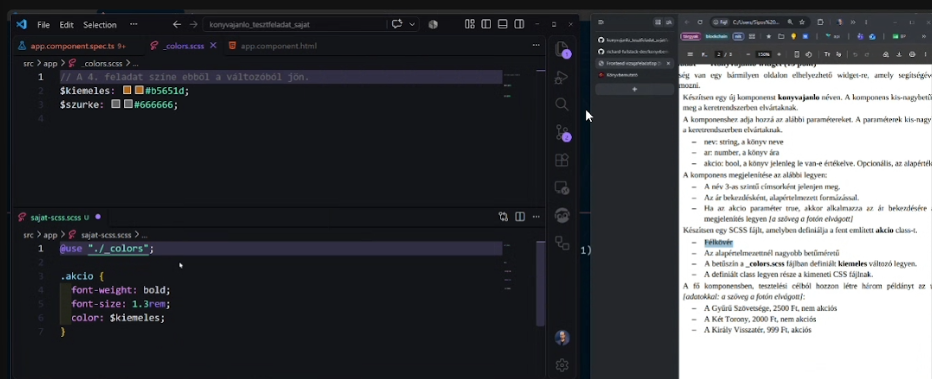

Egyszerű lépésekben magánóráról:
4. feladat colors.scss 4/d rész

Készítsen egy SCSS fájlt, amelyben definiálja a fent említett akcio class-t.
– Félkövér
– Az alapértelmezettnél nagyobb betűméretű
– A betűszín a _colors.scss fájlban definiált kiemeles változó legyen.
– A definiált class legyen része a kimeneti CSS fájlnak.

Kezdet:
Amit feladat ír colors.scss-ba van $kiemeles 

A sajat css-ben (vagy amit a feladat kér) a .akcio class-t létrehozom és a sajat cssben fent a @use-val hivatkozom a vizsgán kapott colors.scss fájlra

@use "./_colors";

